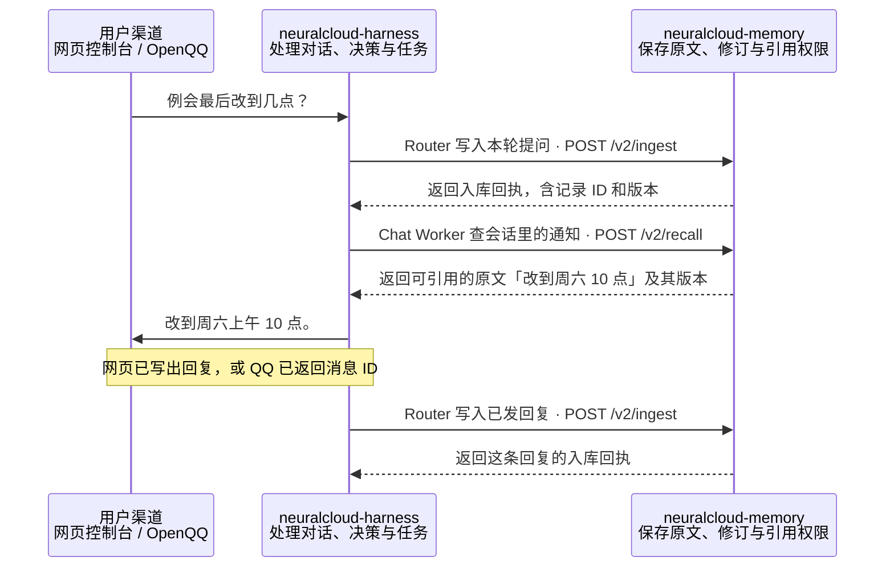

# neuralcloud-harness

NeuralCloud 的 Java 控制面。Chat Worker 处理对话，Router 分派任务并统一写入记忆，Master 根据证据作出决策。Worker 和 Master 可以直接查询独立的常驻记忆服务。[架构提案](docs/proposals/master-worker-cognitive-architecture-20261117.md) · [记忆服务 v1 HTTP 契约](contracts/resident/v1/openapi.v1.json)

## 一次对话怎样读写 Memory v2

假设同一会话里已经有人把例会从周五下午改到了周六上午。图中启用了按会话检索的 Memory v2（`apiVersion=2`、`recallMode=scoped`）。两个 Java 进程通过本机 HTTP 通信，Harness 启动时调用 `GET /v2/health` 核对角色、协议版本和所需能力。[Memory v2 HTTP 契约](https://github.com/QiuYuAkiGO/neuralcloud-memory/blob/45c9c2934483185423b1acf5c62b1abfe05caabd/contracts/v2/openapi.json)



Chat Worker 和任务 Worker 都能按需查询记忆。控制台另有“对话编排”入口，Master 在这里查证并给出回复意图，Router 据此生成计划，编排器再派 Chat Worker 回复。

两边各有自己的 SQLite。Harness 登记待写事件、模型用过的证据版本和变更读取位置。Memory 保存原文、修订、引用授权和持久回执。后续轮次中，Harness 通过 `GET /v2/changes` 发现在用证据的变更，再向 Memory 核对。

## 构建与测试

在仓库根目录使用 JDK 21 和 Maven 运行测试并构建 JAR。

```sh
mvn -f java/pom.xml verify
```

本机模型配置、网页控制台和联调启动命令见 [Java 运行说明](java/README.md)。

## 开发入口

- 开发约定与首期验收范围见[项目守则](AGENTS.md)和[Java 实施方案](docs/proposals/master-worker-router-java-implementation-20261118.md)。
- Master 的模型评测包含[基线方案](docs/proposals/master-qwen35-9b-base-baseline-20261117.md)和[逐例对照结果](docs/harness/2026-11-21-master-9b-27b-case-comparison.md)。

本仓库保留了 2026 年 11 月 17 日至 22 日与框架重构相关的提交。拆分时对接的记忆服务实现可从原项目追溯，记忆系统的后续重构在独立仓库进行。[原项目提交 1c44702](https://github.com/QiuYuAkiGO/NeuralCloud/commit/1c44702af88ec991f3813f18fbf8cc1358dadc9e) · [原服务接口说明](https://github.com/QiuYuAkiGO/NeuralCloud/blob/1c44702af88ec991f3813f18fbf8cc1358dadc9e/docs/interfaces.md) · [neuralcloud-memory](https://github.com/QiuYuAkiGO/neuralcloud-memory)
