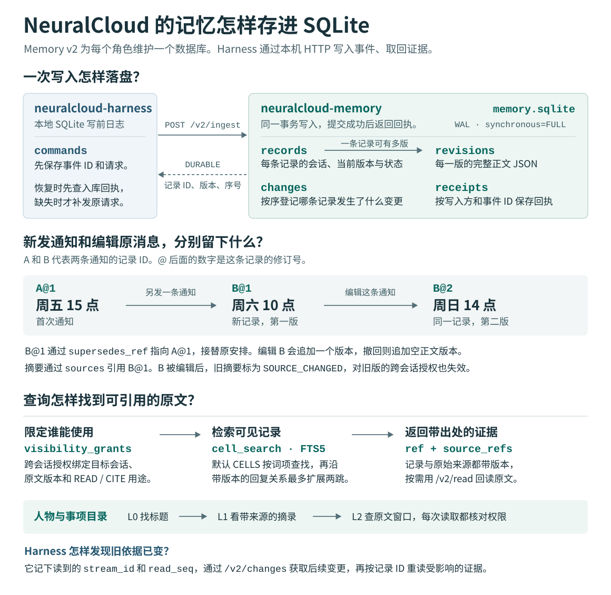

# Memory v2 的记忆怎样存储

用户先说“周五开会”，又说“改到周六”。开发者需要知道最初说了什么，也要能查出现在的安排。NeuralCloud Memory v2 在 SQLite 中分别保存原话、每次修订，以及新安排与旧安排的关系。Harness 通过本机 HTTP 提交事件、读取证据，两个 Java 进程各自持有自己的数据库。

## 一次写入如何取得持久回执

1. **先把待办保存到 Harness。** Router 把用户原话作为 `observation` 提交。渠道确认发出的角色回复记为 `self_expression`。工具尝试 `tool_attempt` 和实际结果 `tool_result` 用同一个 `action_id` 配对，各自入库。发送 HTTP 请求前，Harness 先把事件写进本地 `memory-v2-<角色>.sqlite` 的 `commands` 表。
2. **在 Memory 的一个事务里入账。** 每个角色的数据目录各有一个 `memory.sqlite`。目录锁限制同一时刻的写进程，连接开启 SQLite 预写日志（WAL）、`synchronous=FULL` 和外键校验。一次新增会更新记录、修订、当前全文索引、变更和回执。有来源依赖时一并写入。任何一步失败，事务整体回滚。
3. **同一个事件可以安全重试。** `(source_instance, event_id)` 是幂等键。新增记录时，服务对这两个字段组成的紧凑 JSON 数组取 SHA-256，得到稳定的记录 ID。事务提交后才返回 `DURABLE`、`record_id`、`revision` 和 `seq`。若响应丢失，Harness 恢复时先查 `GET /v2/receipts`。同键同命令返回原回执，同键却换了请求内容或操作会收到 HTTP 409。[写入与回执实现][ledger] · [记录 ID 编码][identity] · [事务与落盘设置][store]

## 原文、版本和提交顺序各存在哪里

库的 `meta` 表绑定角色 `character_id` 和这份历史的 `stream_id`。当前 HTTP 主版本为 2，SQLite 表结构版本为 4。Memory 启动时核对角色，必要时在启动事务中升级已有表和索引。

- **`records` 保存一条记忆的当前状态。** 一行对应一个稳定 ID，还保存会话、写入者、类型、当前修订号和状态。用 ID 和当前修订号关联 `revisions`，就能取到当前正文。
- **`revisions` 保存每一版的内容。** 主键是 `(record_id, revision)`。每一版都有完整 JSON 正文、原事件发生时间和该版的提交序号。正文可以带发言者、场合、渠道消息标识及显式声明的事项。
- **`changes` 和 `receipts` 分别回答两类问题。** 按 `changes.seq` 可以查“这次读取以后，哪些记录发生过变化”。按写入方和事件 ID 查 `receipts` 可以确认“我提交的命令是否已经成功”。一次更正可能连带使多条摘要失效，因此一条命令可以产生多条变更，回执的 `seq` 对应该命令结束时的库内序号。[核心表结构][schema]

## 为什么改期和编辑产生不同的记录

用 A、B 简写两条消息的真实记录 ID。同一条记录的版本写成 `B@1`、`B@2`。

- **另发改期通知。** “周五 15 点开会”存为 `A@1`，另发的“改到周六 10 点”存为 `B@1`。若上报的结构化安排明确用 `supersedes_ref` 指向 `A@1`，新安排生效后查询现行安排会得到周六。查最初的通知仍能读到周五。
- **编辑原通知。** 若原作者把 B 的正文改成“周日 14 点”，调用方提交 `expected_revision=1`，并按新正文重提结构化安排。Memory 给同一 ID 追加 `B@2`，保留 `B@1`。另一个仍基于第 1 版的编辑会得到版本冲突。随后撤回 B 会追加空正文的 `B@3`，当前状态变为 `RETRACTED`。数据库保留修订历史，读接口按当前状态和权限决定可交付的内容。
- **询问过去。** `claim_times` 为显式安排建立生效时间与前序版本索引。`as_of_valid` 选择业务时点，回答“那时哪项安排有效”。`as_of_known_seq` 选择系统当时已经收到的修订，回答“截至那次提交，系统知道什么”。例如周四生效的通知周五才补录，两种询问可以得到不同结果。[会议请求和回执][meeting] · [更正与撤回实现][correct]

## 摘要、印象和授权如何跟随原文

摘要与印象经 `POST /v2/candidates` 写入，各自有记录 ID。读回时标为推断材料（`inferred`）。`sources` 把它们连到具体的来源 ID 和修订号。举例说，摘要 S 依据 `B@1` 写成。B 变成第 2 版时，同一事务会把依赖旧版的在线派生项递归标为 `SOURCE_CHANGED`，移出全文索引并发出变更。查 S 的状态即可知道需要重新取证。[来源依赖与失效实现][correct]

普通历史查询在排序之前就按受众筛选。跨会话使用 QQ 原话时，`visibility_grants` 绑定原作者授权的记录版本、目标会话和用途。`READ` 允许读取，`CITE` 还允许在该会话引用。编辑或撤回原文会使旧版授权失效。只撤销某个受众的授权时，该受众随后读取派生摘要也要重新核对所有来源。本人发言与身份查询另按已绑定的 QQ 身份核验。[授权表与来源视图][grants] · [受众过滤条件][visibility]

## 查询怎样从关键词找到原文

按关键词调用 `POST /v2/recall` 时，默认的 `CELLS` 模式使用 SQLite 的全文检索模块 FTS5。`cell_search` 索引正文、发言者、主题等字段。写入与查询使用相同的分词规则，汉字拆成单字和相邻双字，连续的拉丁字母与数字按词保留。找到可见候选后，服务可沿同会话、版本匹配的 `reply_to` 关系向前后扩展最多两跳。例如“就按这个时间”可以带出它回复的那条通知。查询旧知识序号时会扫描当时的修订切片，避免拿今天的全文索引解释过去。[分词规则][terms] · [检索与回复链扩展][search]

已知事项标识（`subject_id`）时，服务可以直接沿该事项的生效时间和替代关系查找安排。关键词检索还可显式选择基础词法模式 `LEXICAL`、加入归一化日期的 `TEMPORAL`，或结合稀疏 TF-IDF 排序的 `HYBRID`。[查询分派][reader] · [检索模式与默认配置][retrieval]

只有人名或事项名时，也可以走卡片目录。后台根据 `changes` 增量更新 `card_members`，并在同一事务中推进 `catalog_state.cursor`。默认每轮最多处理 16 条变更，轮次间隔 30 秒，因此目录可能稍晚于已提交的原文。用 `/v2/cards` 从 **L0 标题**进入 **L1 带来源的摘录**，需要原话时再用 `/v2/read` 读取 **L2 原文窗口**。展示目录和摘录时仍会核对版本、来源、权限与有效期。[目录与时态索引表][catalog] · [卡片读取实现][cards]

## Harness 怎样知道模型用过的依据变了

Memory 返回的在线证据包含所读记录版本 `ref`、原始来源版本 `source_refs`，以及本次读取所在的 `stream_id` 和 `read_seq`。后两项标识“哪条变更流、读到了哪个序号”。Harness 用本地的 `inputs`、`input_evidence` 保存交给模型的材料和证据快照，用 `watches` 记录后续需要检查的条目。

下一轮通过 `GET /v2/changes` 拉取变更编号、操作和记录版本，再用 `/v2/read` 重读受影响的条目。带有效期的依据即使没有新写入也会重新检查。这样，开发者既能还原上一轮用了哪版原文，也能解释下一轮为什么需要更换依据。[Harness 本地日志][journal] · [变更读取与证据复核][refresh]

[ledger]: https://github.com/QiuYuAkiGO/neuralcloud-memory/blob/45c9c2934483185423b1acf5c62b1abfe05caabd/src/main/java/neuralcloud/memory/Ledger.java#L54
[store]: https://github.com/QiuYuAkiGO/neuralcloud-memory/blob/45c9c2934483185423b1acf5c62b1abfe05caabd/src/main/java/neuralcloud/memory/Store.java
[identity]: https://github.com/QiuYuAkiGO/neuralcloud-memory/blob/45c9c2934483185423b1acf5c62b1abfe05caabd/src/main/java/neuralcloud/memory/Fields.java#L151
[schema]: https://github.com/QiuYuAkiGO/neuralcloud-memory/blob/45c9c2934483185423b1acf5c62b1abfe05caabd/src/main/resources/schema.sql
[meeting]: https://github.com/QiuYuAkiGO/neuralcloud-memory/blob/45c9c2934483185423b1acf5c62b1abfe05caabd/contracts/v2/examples/meeting.json
[correct]: https://github.com/QiuYuAkiGO/neuralcloud-memory/blob/45c9c2934483185423b1acf5c62b1abfe05caabd/src/main/java/neuralcloud/memory/Ledger.java#L335
[grants]: https://github.com/QiuYuAkiGO/neuralcloud-memory/blob/45c9c2934483185423b1acf5c62b1abfe05caabd/src/main/resources/visibility.sql
[visibility]: https://github.com/QiuYuAkiGO/neuralcloud-memory/blob/45c9c2934483185423b1acf5c62b1abfe05caabd/src/main/java/neuralcloud/memory/Visibility.java#L39
[terms]: https://github.com/QiuYuAkiGO/neuralcloud-memory/blob/45c9c2934483185423b1acf5c62b1abfe05caabd/src/main/java/neuralcloud/memory/Terms.java
[search]: https://github.com/QiuYuAkiGO/neuralcloud-memory/blob/45c9c2934483185423b1acf5c62b1abfe05caabd/src/main/java/neuralcloud/memory/CellSearch.java
[reader]: https://github.com/QiuYuAkiGO/neuralcloud-memory/blob/45c9c2934483185423b1acf5c62b1abfe05caabd/src/main/java/neuralcloud/memory/Reader.java#L415
[retrieval]: https://github.com/QiuYuAkiGO/neuralcloud-memory/blob/45c9c2934483185423b1acf5c62b1abfe05caabd/docs/acceptance/memory-v2-stage-3-4.md
[catalog]: https://github.com/QiuYuAkiGO/neuralcloud-memory/blob/45c9c2934483185423b1acf5c62b1abfe05caabd/src/main/resources/catalog.sql
[cards]: https://github.com/QiuYuAkiGO/neuralcloud-memory/blob/45c9c2934483185423b1acf5c62b1abfe05caabd/src/main/java/neuralcloud/memory/CardCatalog.java
[journal]: ../../java/src/main/java/neuralcloud/controlplane/memory/MemoryJournal.java
[refresh]: ../../java/src/main/java/neuralcloud/controlplane/memory/ResidentV2.java
