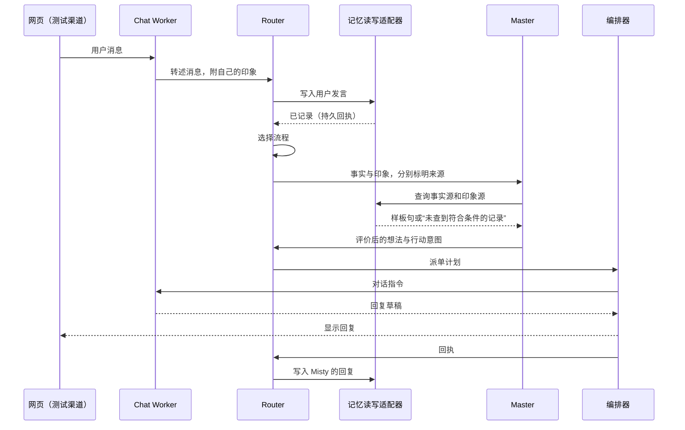

# 网页自由对话走完整链路的方案

2026-11-21 · 方案稿，尚未实施。目标是让操作者在网页控制台以用户身份与 Misty 自由对话，每条消息都经过 Chat Worker、Router、记忆读写适配器、Master 与编排器，回复和中间事件写入同一条审计链。首期流程与角色边界沿用 [Java 实施方案](master-worker-router-java-implementation-20261118.md) 和 [设计修订草稿](master-worker-design-revisions-20261121.md)，开发遵循 [项目守则](../../AGENTS.md)。

## 1. 现状与缺口

会议改期联调已在控制台跑通：网页正文交给真实 Router，Master 读样例证据并提交结果，编排器按决策调度 Chat Worker 与模拟的任务 Worker。自由对话还缺以下能力。

| 环节 | 现状 | 自由对话需要的能力 |
| --- | --- | --- |
| Chat Worker | 只有 `draftReply`，把获准正文改写成 Misty 口吻 | 接收用户消息，向 Router 上报消息与自己的印象；按 Router 的对话指令生成回复 |
| Router | 只在 `MEETING_RESCHEDULE` 与 `UNSUPPORTED` 中选流程 | 增加日常对话流程；把 Master 的意图拆成派单计划 |
| 记忆 | `memory` 包为空，Master 读样例中的证据 | 真实的记忆读写适配器：写入发言与回复，按事实源、印象源查询，返回样板句 |
| Master | 必交结果由各样例定义，如 `meetingTime`、`verifyReminder` | 与事项无关的通用意图契约 |
| 编排器 | 正式 `Orchestrator` 已能按依赖派发 | 执行 Router 生成的计划，回执交回 Router 入库 |
| 网页 | 同步等待节点返回 | 一轮预计 20 至 30 秒，需要边跑边看审计事件 |

## 2. 一轮对话的数据流

网页控制台在本方案中充当测试渠道：网页显示 Chat Worker 的回复即视为送达，显示由控制台自己确认，不经 MistyAI。

1. **接收。** 网页提交 `chain` 与正文。`chain` 即测试会话标识，Java 为消息分配会话内序号和接收时间。
2. **上报。** Chat Worker 读本会话最近若干轮的原文，用纯文本向 Router 转述用户本轮说了什么，可附一句印象，例如“用户可能是在开玩笑”。印象保留提出者，不作为事实入库。
3. **入库与分流。** Router 将用户发言交给适配器写入，取得持久回执后再选流程。写入失败时本轮结束，不调用 Master。
4. **取证与评价。** Master 按实施方案第 1.3 节主动查询事实源和印象源，再提交通用意图（见第 4 节）。
5. **拆解与派发。** Router 把意图拆成派单计划，编排器按依赖执行。首期只有 Chat Worker 一类步骤，任务 Worker 暂不接入。
6. **回复与回流。** Chat Worker 按指令生成回复。网页显示后，编排器把回执交回 Router，Router 将回复作为 Misty 的发言写入记忆。

## 3. 记忆读写适配器

适配器放在 `memory` 包，对外只有两类操作：写入一条记录并返回持久回执，按来源类别查询并返回样板句。HTTP 请求体、原始结果行和异常栈止于适配器。

**待决定：适配器后端。** 实施方案第 1.4 节写的是 Java 直接执行参数化 SQL；修订草稿的外部评审待议事项指出“SQL 在哪里执行、谁拥有写事务”仍需契约。仓库里已有的常驻记忆服务提供 `/v1/ingest`、`/v1/recall`、`/v1/receipts` 和 `/v1/changes`，有持久回执和版本号。[记忆接口契约](../../contracts/resident/v1/openapi.v1.json)

| 做法 | 优点 | 代价 |
| --- | --- | --- |
| 甲：经常驻记忆服务的 HTTP 接口 | 回执、版本、更正和变更流已实现，写事务归属明确 | 查询走服务的召回逻辑，不是固定 SQL 模板；样板句要从 `RecordView` 拼出 |
| 乙：Java 直接对记忆库执行参数化 SQL | 与实施方案一致，查询语义完全可控 | 要先定表结构与事务归属；与 Python 服务并存时有两个写入方 |

建议控制台首期采用甲，以独立的服务实例、数据目录和 `character_id` 运行，不碰生产记忆。乙待 SQL 与事务契约定稿后再替换适配器实现，适配器对 Router 和 Master 的接口不变。

**记录类型。** 首期只写两类记录：用户发言（`kind=observation`）和 Misty 的回复（`kind=self_expression`）。`session_id` 取网页的 `chain`，`event_id` 由 Java 生成并随审计事件保留。Chat Worker 的印象只随本轮材料交给 Master，Master 形成的印象暂不入库。

**查询。** 事实查询按当前会话和关键词召回发言，印象查询首期固定返回“未查到符合条件的记录。”，直到印象入库方式确定。命中记录按实施方案第 1.2 节的发言句式渲染，并附可见范围：“这条消息仅可在本次网页测试会话中引用。”

## 4. Master 的通用意图契约

会议改期样例的必交结果是按事项定制的。自由对话需要一套与事项无关的结果，供 Router 拆解。建议沿用原生工具调用，先 `query_memory`，再 `submit_intent`。

| 字段 | 类型 | 含义 |
| --- | --- | --- |
| `assessment` | 非空字符串 | Master 对本轮材料的评价，用“根据……，我目前倾向于……”表达依据和主观性 |
| `replyIntent` | 非空字符串 | 希望 Misty 向用户传达的意思，不是最终措辞 |
| `evidence` | 本轮查询结果的序号数组 | `assessment` 中事实性表述所依据的记录；可为空 |
| `needsReply` | 布尔值 | 本轮是否需要回复。为 `false` 时 Router 不派对话指令 |

校验在 Master 边界完成。字段缺失、多余或类型不符，`evidence` 引用本轮未返回的序号，都按同一条“`submit_intent` 不符合意图契约”拒绝，并指出违反的字段。按现有 Master 挡板的做法，允许一次补交，仍不合格则本轮失败。

## 5. Router 的扩展

- **流程枚举。** `Route` 增加 `CONVERSATION`（日常对话）。会议改期仍由 `MEETING_RESCHEDULE` 处理；`UNSUPPORTED` 时 Router 只让 Chat Worker 告知暂时处理不了，不调用 Master。
- **意图拆解。** Router 用 `submit_plan` 工具提交步骤列表，每步含 `id`、`worker`、`text`、`dependsOn`。`worker` 首期只允许 `CHAT_WORKER`，`text` 是给 Chat Worker 的纯文本指令。计划交给正式 `Orchestrator`，它已在任何 Worker 动作前校验标识唯一、依赖存在且无环。
- **拆解是否用模型。** 首期计划只有一步对话指令，也可由 Java 直接从 `replyIntent` 生成。建议仍让 Router 的 0.8B 生成，提前暴露小模型拆解的稳定性问题；若实测不稳定，退回 Java 生成并记录原因。

## 6. 网页与审计

- **异步提交。** `POST /api/pipeline/messages` 校验后立即返回 `202` 和请求事件号，后台执行。网页每秒拉取该会话的审计链，按事件逐步显示“Router 已分流”“Master 查询记忆”等进度，回复事件到达时显示在对话区。
- **单会话串行。** 同一 `chain` 上一轮未结束时，新的提交返回 `409`，指出该会话仍在处理。不同会话可以并行，但 Master 与 Router 的推理服务均以 `--parallel 1`、`--max-num-seqs 1` 运行，实际会排队。
- **审计事件。** 沿用现有事件类型，新增 `chat_report`、`memory_write`（含回执的 `record_id` 与 `revision`）、`intent`、`plan` 和 `delivery`。各步以 `causedBy` 指向直接起因。任一步失败记 `node_failed` 并结束本轮，已获回执的写入保留。

## 7. 启动方式

自由对话面向正式功能，放在正式入口 `ConsoleMain`，不放测试代码。是否挂载“完整链路”节点由配置决定：新增一份 `console-pipeline.properties`，在 `console.properties` 的字段之外必填记忆服务地址、令牌环境变量名、`characterId`、Master 意图轮的 token 上限与温度。字段集合按现有配置的规则精确校验。启动顺序在现有阶段之后加两步：探测记忆服务 `/v1/health`，再组装 Router 拆解与编排器，任一步失败即退出。

## 8. 实施顺序与验收

| 步骤 | 内容 | 验收 |
| --- | --- | --- |
| 1. 适配器 | `memory` 包接入常驻记忆服务，写入发言，按会话查询并渲染样板句 | 用测试实例写入两条发言，查询返回带可见范围的样板句；未命中返回固定空结果 |
| 2. 通用意图 | Master 增加 `submit_intent`，补最小挡板用例 | 合格提交通过；引用不存在的证据序号被拒绝并指出字段 |
| 3. Router 拆解 | `CONVERSATION` 流程与 `submit_plan` | 0.8B 对日常问候生成一步合法计划；非法计划在派发前被拒 |
| 4. Chat Worker 上报 | 新增上报调用，返回转述和印象 | 上报正文不含 JSON 等结构化内容，印象标明提出者 |
| 5. 网页 | 异步提交、进度轮询、会话串行 | 一轮对话在网页逐步显示进度并得到 Misty 回复；第二轮能引用第一轮已入库的发言 |

整条链路的首个验收例：第一轮说“我周六下午要去看展”，第二轮问“我周六要干嘛来着？”。第二轮的审计链中，Master 的事实查询应命中第一轮发言的记录，`intent.evidence` 引用该记录，Misty 的回复提到看展。

## 9. 待决定事项

1. 适配器后端采用甲（常驻记忆服务）还是乙（Java 直接执行 SQL）。
2. Master 的印象首期是否入库。若入库，需要确定写入预算和“可修订印象”的记录形式。
3. 意图拆解首期由 Router 的 0.8B 生成，还是由 Java 直接生成。
4. 任务 Worker 是否在首期接入。当前没有自由对话可调用的真实任务能力，建议暂不接入。
