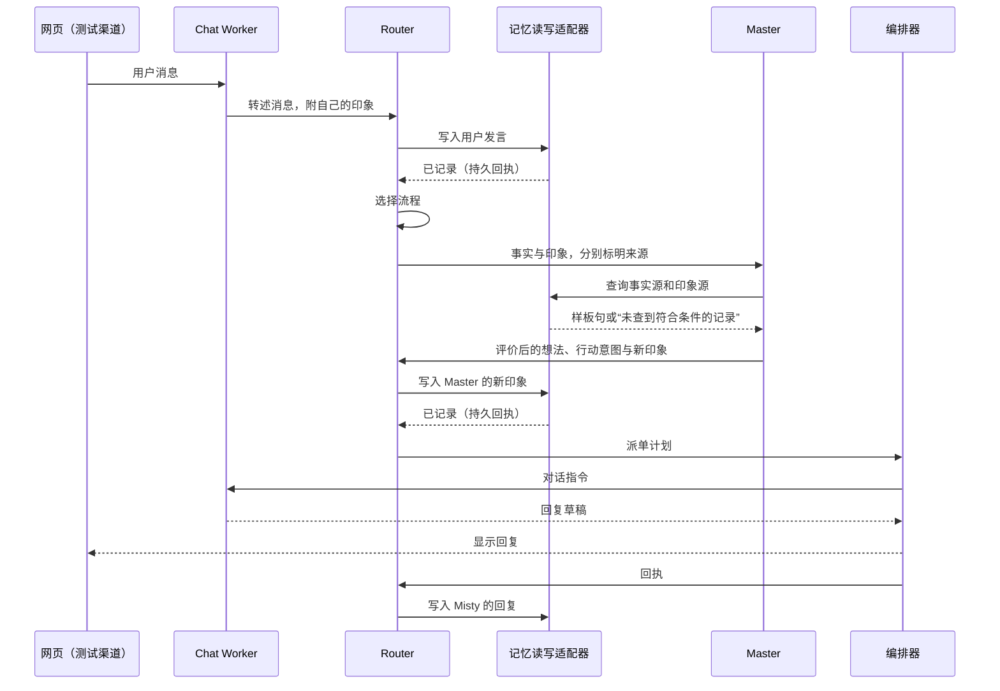

# 网页自由对话走完整链路的方案

2026-11-21 提案，2026-11-23 更新。第 4、5 节记录正式控制台已接入的 Master 意图和 Router 派单契约。目标是让操作者在网页控制台以用户身份与 Misty 自由对话，回复和中间事件写入同一条审计链。首期流程与角色边界沿用 [Java 实施方案](master-worker-router-java-implementation-20261118.md) 和 [设计修订草稿](master-worker-design-revisions-20261121.md)，开发遵循 [项目守则](../../AGENTS.md)。

## 1. 提案时的现状与缺口

会议改期联调已在控制台跑通：网页正文交给真实 Router，Master 读样例证据并提交结果，编排器按决策调度 Chat Worker 与模拟的任务 Worker。自由对话还缺以下能力。

| 环节 | 现状 | 自由对话需要的能力 |
| --- | --- | --- |
| Chat Worker | 只有 `draftReply`，把获准正文改写成 Misty 口吻 | 接收用户消息，向 Router 上报消息与自己的印象；按 Router 的对话指令生成回复 |
| Router | 正式节点已区分 `CONVERSATION`、`ACTION_REQUEST` 与 `UNSUPPORTED`。会议改期路由属于联调场景。 | 将日常对话接入完整流程，并把 Master 的意图拆成派单计划 |
| 记忆 | `memory` 包为空，Master 读样例中的证据 | 真实的记忆读写适配器：写入发言与回复，按事实源、印象源查询，返回样板句 |
| Master | 必交结果由各样例定义，如 `meetingTime`、`verifyReminder` | 与事项无关的通用意图契约 |
| 编排器 | 正式 `Orchestrator` 已能按依赖派发 | 执行 Router 生成的计划，回执交回 Router 入库 |
| 网页 | 同步等待节点返回 | 一轮预计 20 至 30 秒，需要边跑边看审计事件 |

## 2. 一轮对话的数据流

网页控制台在本方案中充当测试渠道：网页显示 Chat Worker 的回复即视为送达，显示由控制台自己确认，不经 MistyAI。

1. **接收。** 网页提交 `chain` 与正文。`chain` 即测试会话标识，Java 为消息分配会话内序号和接收时间。
2. **上报。** Chat Worker 读本会话最近若干轮的原文，用纯文本向 Router 转述用户本轮说了什么，可附一句印象，例如“用户可能是在开玩笑”。印象保留提出者，不作为事实入库。
3. **入库与分流。** Router 将用户发言交给适配器写入，取得持久回执后再选流程。写入失败时本轮结束，不调用 Master。
4. **取证与评价。** Master 按实施方案第 1.3 节主动查询事实源和印象源，再提交通用意图（见第 4 节）。
5. **拆解与派发。** Router 写入 Master 的新印象，再把意图拆成派单计划，编排器按依赖执行。首期只有 Chat Worker 一类步骤，任务 Worker 不接入。
6. **回复与回流。** Chat Worker 按指令生成回复。网页显示后，编排器把回执交回 Router，Router 将回复作为 Misty 的发言写入记忆。

## 3. 记忆读写适配器

适配器放在 `memory` 包，对外只有两类操作：写入一条记录并返回持久回执，按来源类别查询并返回样板句。HTTP 请求体、原始结果行和异常栈止于适配器。

**已决定：后端接常驻记忆服务。** 仓库里已有的常驻记忆服务提供 `/v1/ingest`、`/v1/candidate`、`/v1/recall`、`/v1/receipts` 和 `/v1/changes`，有持久回执和版本号，写事务由服务持有。[记忆接口契约](../../contracts/resident/v1/openapi.v1.json) 控制台以独立的服务实例、数据目录和 `character_id` 运行，不碰生产记忆。实施方案第 1.4 节的“Java 直接执行参数化 SQL”待 SQL 与事务契约定稿后再替换适配器实现，适配器对 Router 和 Master 的接口不变。查询走服务的召回逻辑而非固定 SQL 模板，这一差异在替换前保留。

**记录类型。** `session_id` 取网页的 `chain`，`event_id` 由 Java 生成并随审计事件保留。

| 记录 | 写入方式 | 写入方 |
| --- | --- | --- |
| 用户发言 | `/v1/ingest`，`kind=observation` | Router，取得回执后才调用 Master |
| Misty 的回复 | `/v1/ingest`，`kind=self_expression` | Router，网页显示回复之后 |
| Master 的印象 | `/v1/candidate`，`kind=summary`，`source_ids` 为该印象引用的记录标识 | Router，按 Master 提交的意图写入 |

Chat Worker 的印象只随本轮材料交给 Master，不入库；Master 评价后形成的印象才写入，并显式记为 Master 的可修订印象。服务要求候选记录必须有来源，所以没有引用记录的印象不写入。首期只新增印象，修订已有印象经 `/v1/corrections` 带 `expected_revision` 完成，留到后续。

**查询。** 适配器按当前会话和关键词召回，按返回记录的 `kind` 分成事实源（`observation`、`self_expression`）和印象源（`summary`）。命中记录按实施方案第 1.2 节的句式渲染并附可见范围。发言渲染为“用户在《时间》说：“《内容》”。这条消息仅可在本次网页测试会话中引用。”；印象渲染为“我在《时间》形成的印象是：《内容》。依据是《所引记录的说明》。”某一类无命中时，该类返回“未查到符合条件的记录。”

## 4. Master 的通用意图契约

会议改期样例的必交结果按事项定制。通用意图使用原生工具调用，先由 Master 通过 `memory_call` 查询，再通过 `submit_intent` 一次提交以下五个字段。控制台 Master 节点以 `/intent <事项正文>` 启动这项操作。Memory v2 为当轮查询提供可复核的记录版本。

| 字段 | 类型 | 含义 |
| --- | --- | --- |
| `assessment` | 非空字符串 | Master 对本轮材料的评价，用“根据……，我目前倾向于……”表达依据和主观性 |
| `replyIntent` | 非空字符串 | 包含能回答问题的具体事实。引用已核验的 QQ 群通知时，Master 用「」逐字标出所需片段，Chat Worker 须保留选定的原文 |
| `evidence` | 本轮查询结果的整数序号数组 | 正文中标有“证据 1”等编号的记录，从 1 开始。范围说明、热目录、刷新通知和空结果不分配序号。允许空数组 |
| `impression` | 字符串 | 本轮形成的新印象；空字符串表示不形成新印象。非空时须以“根据……，我目前倾向于……”表达，且 `evidence` 不可为空 |
| `needsReply` | 布尔值 | 本轮是否需要回复。为 `false` 时 Router 不派对话指令 |

校验在 Master 边界完成。参数不合法时返回“`submit_intent` 不符合意图契约”及违反的字段或规则，允许模型用同一批证据完整重提一次。宿主在接受前复核证据，将序号按提交顺序解析成实际交付的 `record_id` 和 `revision`。成功的 `intent` 事件以本轮记忆工具回执为直接起因，保留五个字段供审计及后续派单。

## 5. Router 的扩展

- **流程枚举。** `CONVERSATION` 进入日常对话链路。`ACTION_REQUEST` 识别本轮实时查询或外部行动需求，能力及授权由执行层判定。首期未接入的动作返回对应的能力状态。`UNSUPPORTED` 用于明确越过系统边界的请求。会议改期的 `MEETING_RESCHEDULE` 仍用于独立联调场景。
- **意图拆解。** Router 用 `submit_plan` 工具提交步骤列表，每步含 `id`、`worker`、`text`、`dependsOn`。`worker` 首期只允许 `CHAT_WORKER`，`text` 是给 Chat Worker 的纯文本指令。计划交给正式 `Orchestrator`，它已在任何 Worker 动作前校验标识唯一、依赖存在且无环。
- **拆解由 Router 模型生成。** 正式配置使用 DeepSeek 官方 API 的 `deepseek-flash`。Master 接受意图后，Router 仅将 `replyIntent` 交给模型。当 `needsReply=false` 时结束本轮。

正式控制台“对话编排”节点使用同步消息接口处理 `CONVERSATION`。其他路由返回分类结果。模型须通过一次完整的原生 `submit_plan` 调用提交恰含一个元素的 `steps` 数组。步骤字段必须齐全且唯一，`id` 与 `text` 为非空字符串，`worker=CHAT_WORKER`，`dependsOn=[]`。无效提交终止本轮。宿主绑定会话与工作流，在派单和交付前复核证据版本。审计记录工具调用 ID、步骤正文及工作流 ID。Chat Worker 按步骤表达 Master 批准的内容，控制台写出 HTTP 回复后登记送达并入库。

## 6. 网页与审计

- **异步提交。** `POST /api/pipeline/messages` 校验后立即返回 `202` 和请求事件号，后台执行。网页每秒拉取该会话的审计链，按事件逐步显示“Router 已分流”“Master 查询记忆”等进度，回复事件到达时显示在对话区。
- **单会话串行。** 同一 `chain` 上一轮未结束时，新的提交返回 `409`，指出该会话仍在处理。不同会话可以并行，但 Master 与 Router 的推理服务均以 `--parallel 1`、`--max-num-seqs 1` 运行，实际会排队。
- **审计事件。** 沿用现有事件类型，新增 `chat_report`、`memory_write`（含回执的 `record_id` 与 `revision`）、`intent`、`plan` 和 `delivery`。各步以 `causedBy` 指向直接起因。任一步失败记 `node_failed` 并结束本轮，已获回执的写入保留。

## 7. 启动方式

自由对话面向正式功能，放在正式入口 `ConsoleMain`，不放测试代码。是否挂载“完整链路”节点由配置决定：新增一份 `console-pipeline.properties`，在 `console.properties` 的字段之外必填记忆服务地址、令牌环境变量名、`characterId`、Master 意图轮的 token 上限与温度。字段集合按现有配置的规则精确校验。启动顺序在现有阶段之后加两步：探测记忆服务 `/v1/health`，再组装 Router 拆解与编排器，任一步失败即退出。

## 8. 实施顺序与验收

| 步骤 | 内容 | 验收 |
| --- | --- | --- |
| 1. 适配器 | `memory` 包接入常驻记忆服务，写入发言和印象，按会话查询并分类渲染样板句 | 用测试实例写入两条发言和一条带来源的印象，查询分别返回事实与印象样板句；某类未命中返回固定空结果 |
| 2. 通用意图 | Master 增加 `submit_intent`，补最小挡板用例 | 合格提交通过；引用不存在的证据序号、无引用的非空印象都被拒绝并指出字段 |
| 3. Router 拆解 | `CONVERSATION` 流程与 `submit_plan` | 云端 Router 生成一步对话计划；非法计划在派发前被拒；两轮看展对话可追到首轮原文版本 |
| 4. Chat Worker 上报 | 新增上报调用，返回转述和印象 | 上报正文不含 JSON 等结构化内容，印象标明提出者 |
| 5. 网页 | 异步提交、进度轮询、会话串行 | 一轮对话在网页逐步显示进度并得到 Misty 回复；第二轮能引用第一轮已入库的发言 |

整条链路的首个验收例：第一轮说“我周六下午要去看展”，第二轮问“我周六要干嘛来着？”。第二轮的审计链中，Master 的事实查询应命中第一轮发言的记录，`intent.evidence` 引用该记录，Misty 的回复提到看展。

## 9. 已决定与仍待定的事项

2026-11-21 项目方决定：适配器接常驻记忆服务；Master 的印象首期入库；意图拆解由 Router 的 0.8B 生成；任务 Worker 首期不接入。

仍待定：
- **印象写入预算。** 每轮都可能产生新印象。是否限制每个会话的印象条数，以及印象与事实在召回结果中的配额，待首期实测后再定。
- **印象修订。** 后续印象与已有印象矛盾时，是新增一条还是经 `/v1/corrections` 修订原记录。
