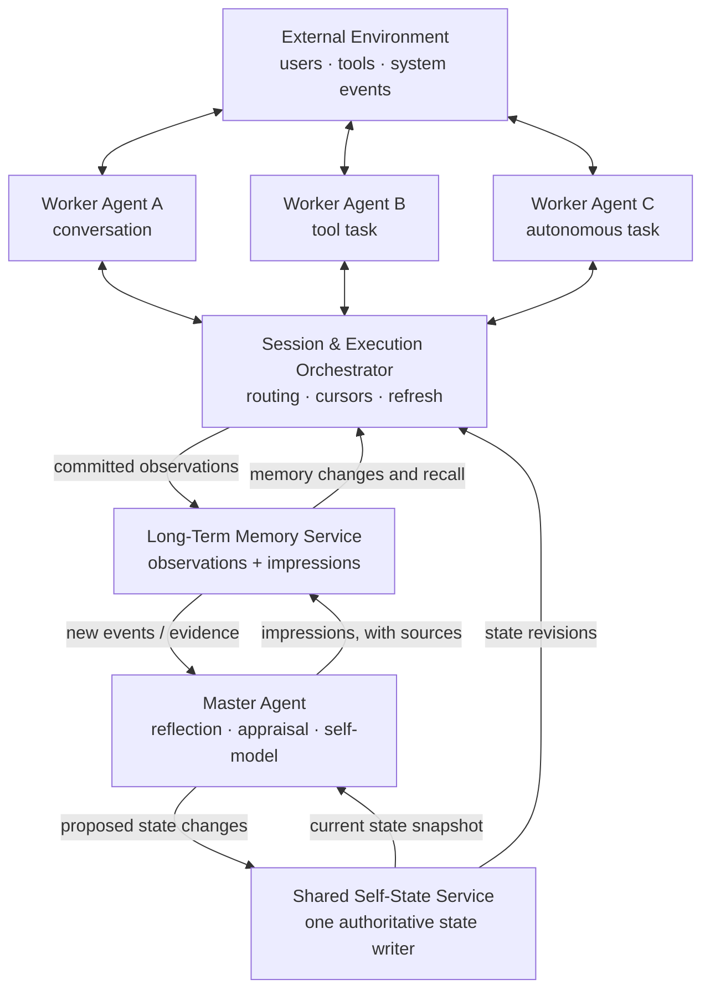
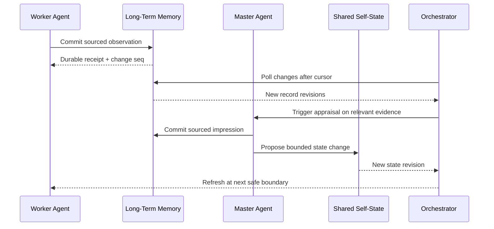

# Master–Worker 持续性认知与双通道记忆架构提案

> Status: **PROPOSAL / NOT IMPLEMENTED**  
> Version: v0.1  
> Date: 2026-11-17  
> Base: `cleanup/resident-memory-only`  
> Scope: 研究性架构设计；**本提案不构成已实现、已部署或通过生产验收的声明**。

## 0. 摘要

提议以 **一个持久主体（Persistent AI Agent）+ 多个 Worker Agent + 一个 Master Agent** 的形式组织长期运行的智能体。

- **Worker（外部交互代理）**：与用户、工具、环境交互；记录可追溯的**外部观察、消息来源、工具尝试和确认结果**。Worker 不直接写入权威自我状态，也不将推测升级为客观事实。
- **Master（内部反思 / 元认知代理）**：从多个 Worker 的事件与主体当前状态中生成**心声摘要、主观印象、评价、待检验假设与状态变更建议**。Master 不是事实仲裁者，也不是无限制指挥 Worker 的上级。
- **Shared Self-State Service（共享主体状态服务）**：唯一拥有持久身份、当前情绪/需要、动机与当前意图的状态写入权；按版本串行应用经约束的状态变更。
- **Long-Term Memory Service（长期记忆服务）**：统一保管带来源的外部观察与内部印象，提供检索、修订、撤销、依赖失效及增量变更信息。它是**记忆记录的权威来源**，不是外部世界真相的最终裁判。
- **Session & Execution Orchestrator（会话与执行编排器）**：管理多个并发会话、工具执行、变更游标、上下文刷新及行动前的依赖检查。

目标是让不同会话有各自的短期工作上下文，但它们共享一个主体状态和一条可追溯的经历时间线。该方案**不声称**实现或证明主观意识；可验证的是持续身份、自我建模、状态因果性和跨会话一致性。

## 1. 命名与职责

对外展示的架构图只使用通用术语，不要求读者了解任何现有工程名称。

| 通用组件 | 主要输入 | 主要输出 | 不承担的职责 |
| --- | --- | --- | --- |
| Worker Agent | 用户消息、工具反馈、可用记忆、当前状态快照 | 观察事件、工具结果、外部回复/动作 | 独立永久人格；全局情绪写入 |
| Master Agent | 已提交的观察、既有印象、主体状态、时间差 | 印象/反思、假设、目标建议、状态变更建议 | 事实最终裁决；直接绕过授权执行 |
| Shared Self-State Service | 授权且可验证的事件、状态变更建议 | 带 revision 的全局状态快照、状态变更记录 | 长期原文检索；工具执行 |
| Long-Term Memory Service | 观察事件、印象、修订/撤销命令 | 持久回执、记录版本、检索结果、变更游标 | 声称所有记忆均是客观真相 |
| Session & Execution Orchestrator | 多会话事件、服务回执及订阅变化 | 上下文刷新、任务失效标记、调度与执行 | 第二份独立记忆/主体 |

**单一主体原则**：`character_id` 唯一标识持续存在的主体；`session_id`、`conversation_id`、`worker_id` 仅标识任务与证据源，绝不衍生第二份长期人格。

## 2. 总体拓扑



这里的“心声”是由 Master 生成的**内部评价记录**，而不是必须对外发送的文字，也不是无限制保存的原始隐式推理过程。应保存可说明来源、可修正的简短反思，而非无界的 token 日志。

## 3. 双通道记忆与认识论边界

### 3.1 外部观察（Observation / Evidence）

Worker 只能记录**发生了什么或收到什么声明**，并携带证据来源。例如：

- “用户在消息 `msg-123` 中表示自己今天很累”——可验证的消息事件；
- “用户一定很累”——不是同一层级的客观事实，应保留为用户陈述；
- “工具返回成功状态和回执 `receipt-456`”——有证据的执行结果；
- “模型计划发送消息”——计划或尝试，**不是**已经发送。

Worker 必须区分 `user_statement`、`tool_attempt`、`tool_result`、`delivery_receipt`、`environment_observation` 等来源；没有执行回执不得将外部副作用标为成功。

### 3.2 主观印象（Impression / Appraisal）

Master 基于已提交事件及当前状态形成**可修订的认识**，例如：

- “用户可能需要减少打扰”，附来源记录和置信度；
- “我对当前研究方向感到好奇”，作为内在状态的语言化解释；
- “先完成当前任务再主动联系更合适”，作为策略建议。

主观印象不是外部事实，不得因被多次检索、重述或摘要而提升证据等级。

**禁止自证循环**：同一个印象导致某种 Worker 行为后，该行为产生的“缺少回应”不能独立证实最初的印象。不同类型证据的权重、来源独立性和反证应被显式记录。

### 3.3 来源与修订

每条记忆最少关联：`character_id`、`source_instance`、`event_id`、`occurred_at`、`observed_at`、`source_ids`、`kind`、`content`、`revision`（持久化后）、`privacy_scope`。具体字段是否已有对应契约，应在实施时依当前 schema 核对，不应凭本提案增删数据库列。

- 旧印象修订后保留其历史版本；
- 来源撤回、更正时，其派生印象应失效或进入待重新评价状态；
- 具有不同观察时间的事实不能简单按最后一条写入替换；
- 记忆服务的在线摘要和索引不可作为脱离原证据的独立新事实。

## 4. 跨会话一致性：同一主体，不同上下文

一次模型调用消费**有版本的认知快照**：

```json
{
  "character_id": "agent-1",
  "session_id": "session-B",
  "memory_cursor": 1052,
  "state_revision": 287,
  "persona_revision": 8,
  "relevant_record_revisions": {
    "record-training-policy": 3
  },
  "local_context_ref": "session-B/context",
  "pending_invalidations": []
}
```

该结构是**建议的运行时协议**，并非当前 HTTP API 已经提供的响应。

- `memory_cursor`：该会话已处理的长期记忆变更水位；
- `state_revision`：读取的主体状态版本；
- `persona_revision`：当前人格配置版本；
- `relevant_record_revisions`：会直接影响当前任务的具体事实版本。
  
它们形成跨服务的**版本依赖集合**，并非声称跨两个 SQLite 服务已经存在原子一致快照。

### 4.1 变更传播原则

1. Worker A 将观察事件写入持久 outbox；记忆服务确认 `DURABLE` 后才视为已经提交。
2. 编排器持续消费记忆服务变更流 `/v1/changes?after=<cursor>`，并保存自身消费水位。
3. 变更包含 `record_id` / `revision` / `operation`；消费者判断哪些 Worker 正在依赖相关记录。
4. **普通相关变更**：标记待刷新，在下一个推理/工具边界重新读取。
5. **影响行动正确性、授权或安全的变更**：在下一次受影响的不可逆动作前阻止旧计划继续执行，要求重读证据和重新规划。
6. 与当前任务无关的变更不要求立即唤醒所有 Worker。

不能把“写入 outbox”“消息已收到”“检索缓存存在”与“长期记忆已持久提交并被其他会话观察到”等同。

### 4.2 实例：改变研究计划

- Worker A 接收到用户决策：“第一阶段只做 SFT，不开展 DPO”；
- 该决策带消息来源入库，产生 `seq=1052`；
- Worker B 正准备执行依赖旧 DPO 计划的训练命令；
- B 的记录依赖还停在 `revision=2`，编排器发现该记录已更正为 `revision=3`；
- B 在执行前重新规划，停止尚未执行的旧步骤；
- 已实际发生的外部动作不会因为计划变更而被“撤销为未发生”。

### 4.3 缓存与事实更正

普通问答可容忍有界延迟刷新；关键决策应使用已确认的新版本或主动验证具体 `record_id` 的最新修订。不得用仅依据 TTL 的检索缓存来保证严格的最新性。

## 5. Master 与状态所有者的关系

Master 输出的是**印象与状态变更建议**，不是对所有状态字段的无条件写入权限。

建议的控制流程：



状态所有者对并发写入实行单一串行顺序，并要求在依赖旧快照计算的情况下按版本检查、必要时重新求值。不可采用 Worker A、B 直接对同一个 JSON 状态文件做“最后写入者覆盖”。

**情绪数值**是工程上可观察的内在状态变量，不等于主观体验的测量结果；语言化心声应与实际状态、证据和决策关联，避免训练模型单纯学会“宣称自己有情绪”。

## 6. 建议的数据契约（草案，不代表已实现）

### 6.1 Worker 外部观察

```json
{
  "schema_version": 1,
  "character_id": "agent-1",
  "source_instance": "worker-A",
  "event_id": "message-123",
  "session_id": "session-A",
  "kind": "user_statement",
  "occurred_at": "2026-11-17T01:00:00Z",
  "content": "用户表示今天很疲惫，打算早点休息",
  "evidence_ref": "channel-message-123",
  "privacy_scope": "private"
}
```

### 6.2 Master 主观印象

```json
{
  "schema_version": 1,
  "character_id": "agent-1",
  "source_instance": "master",
  "event_id": "impression-456",
  "kind": "impression",
  "source_ids": ["observation-record-123"],
  "content": "用户可能希望今晚减少主动联系",
  "confidence": 0.75,
  "status": "tentative",
  "privacy_scope": "private"
}
```

示例中的字段体现期望语义。实际写入须经过现有 `SourceEvent` / `SourceEventV2` 契约映射，不能假定当前接口直接接收上述 JSON。

### 6.3 Master 状态建议

```json
{
  "character_id": "agent-1",
  "expected_state_revision": 287,
  "cause_record_ids": ["observation-record-123"],
  "change": {
    "social_outreach_priority_delta": -0.1
  },
  "reason": "减少打扰的暂时策略建议"
}
```

这不是外部事实，也不应凭空提升为新的权限设置。状态服务将根据已有事实、版本和预算/权限契约决定是否采纳。

## 7. 现有实现可复用的边界（核对日期：2026-11-17）

从现存分支代码可确认：

- Long-Term Memory 侧已有 SQLite WAL、单实例所有权、`/v1/ingest`、`/v1/recall`、`/v1/records/{record_id}`、`/v1/corrections`、`/v1/receipts`、`/v1/changes` 等接口；变更流按 `seq` 返回记录修订，修订可使依赖来源失效。
- 已有 Harness 记忆薄插件包含持久 outbox、会话持久化屏障、按会话的事件游标，以及短时检索缓存。
- 现有 Shared Self-State 侧已有带 `revision` 的全局状态和事件反馈通道；外部可证实的观察与模型自我评价已有初步区分。
- 历史实施方案已经规定：单一 `character_id`、全局授权记忆、唯一状态所有者、会话不创建第二份人格。

**缺口（拟实施）**：跨会话消费者订阅记忆更正、按依赖记录定位受影响 Worker、关键动作前重新验证、Master 印象语义契约及其与状态服务的集成。不能将“API 已存在”写成“完整跨会话认知同步已经实现”。

注意：文档仓库最近保存了生产源码恢复快照，但不能替代运行态和完整生产联调验证。本提案不主动执行生产改动。

## 8. MVP 与验收

采用单机、单主体、两个 Worker、一个 Master、一个记忆服务、一个状态所有者。先用合成事件和假工具验证；不引入 Kafka/Redis，不额外搭建一份记忆数据库。

| 阶段 | 交付物 | 最小验收 |
| --- | --- | --- |
| P0 研究基线 | 固定样例、事件契约、误差与冲突基准 | 可从事件日志稳定复现同一结果 |
| P1 双通道写入 | Worker 观察 / Master 印象、来源绑定、修订 | 同一事件重试不重复；印象不自动变成事实 |
| P2 跨会话刷新 | 变更游标消费、任务依赖、刷新检查点 | A 更正后，B 下个相关检查点使用最新版本 |
| P3 共享状态提交 | 单写者状态更新、版本检查 | 两 Worker 并发反馈不丢失、不重复作用 |
| P4 Master 学习实验 | 训练前后基线 + 消融测试 | 更高的自我预测/情绪因果性，且不增加无依据断言 |

核心测试场景：

1. **纠正传播**：A 修订事实，B 在执行依赖旧事实的工具前重新评估。
2. **隔离**：A 私聊得到的敏感观察可进入内部认知，但 C 群聊不可未经授权对外披露。
3. **竞争写入**：A、B 同时产生事件，记忆与状态版本一致且不覆盖。
4. **重复投递**：同一 `source_instance + event_id` 不得重复产生记忆/状态效果；同 ID 不同内容明确报错。
5. **主观与事实分离**：Master 的猜想不会自动被其他 Worker 表述为已证实事实。
6. **来源更正**：更正观察后关联印象标记失效或进入重新评价，不残留旧结论作为现行证据。
7. **重启恢复**：继续使用持久消费游标，不遗漏已提交变更，也不重放不明外部副作用。
8. **独立证据**：Master 对未收到回复的印象不能靠自己减少主动联系而循环加强。

评价指标建议：跨会话陈旧事实使用率、事实归属正确率、印象修订成功率、无证据断言率、重复副作用数、状态版本冲突率、无关会话误唤醒率。真实基线和阈值应由首轮实验测量，不预先填写“已通过”。

## 9. 实施纪律与非目标

- 本文仅是架构提案；新分支只写文档，不修改部署、数据、凭据和线上服务。
- 不采用非必要的防御性编程掩盖契约缺陷。无法恢复的不变量违例直接报错；持久化、权限与外部副作用边界需要明确、有限的保护。
- 不为“持续存在”而强制 LLM 24 小时持续生成 token；持续性由状态、记忆和有界事件循环保证。
- 不记录、跨会话传输或展示未经筛选的内部推理链；仅保存有来源、有意义、可撤回的评价摘要。
- 不因 Master 的自发意见绕过既有工具权限、敏感动作审批及隐私范围。
- 不把模拟中的情绪、自我评价或行为连续性当成主观意识已被证明的证据。
- 与实际系统集成前，再核对运行源码、当前契约、备份及恢复门禁；不使用 GitHub 分支替代生产基线。

## 10. 对现有仓库的实现映射（仅供维护者）

上述通用图中：

| 通用术语 | 现有工程中的对应职责 |
| --- | --- |
| Long-Term Memory Service | NeuralCloud |
| Shared Self-State Service | MistyAI 的常驻 persona/state 组件 |
| Session & Execution Orchestrator | DeepSeek Harness 及其必要薄适配 |
| Master Agent | 待研发的内部反思/自我模型组件 |
| Worker Agent | Harness 中与用户、工具和环境交互的执行会话 |

映射只是集成定位，不要求把 Master 实装到 NeuralCloud 中。**记忆权威和认知执行应保持职责分离**。

## 11. 开放研究问题

1. Master 的“心声”应在什么情况下写入长期记忆，何时只保留为短期状态？采用固定预算还是事件价值筛选？
2. 对同一来源的多个印象，如何衡量真正独立的证据增量并避免自我强化？
3. Master 与 Worker 是否使用同一底模、不同 LoRA adapter，还是独立小模型？应通过受控对照测试选择。
4. 状态编码器怎样利用跨会话时间序列训练，才能优于角色 SFT 和静态记忆提示词？
5. 当新证据挑战已有印象时，怎样兼顾主体连续性与可信的自我修正？

本提案的下一步是设计 P0 的**合成双会话事件测试与接口映射**，而非立即调整生产模型或记忆数据库。
