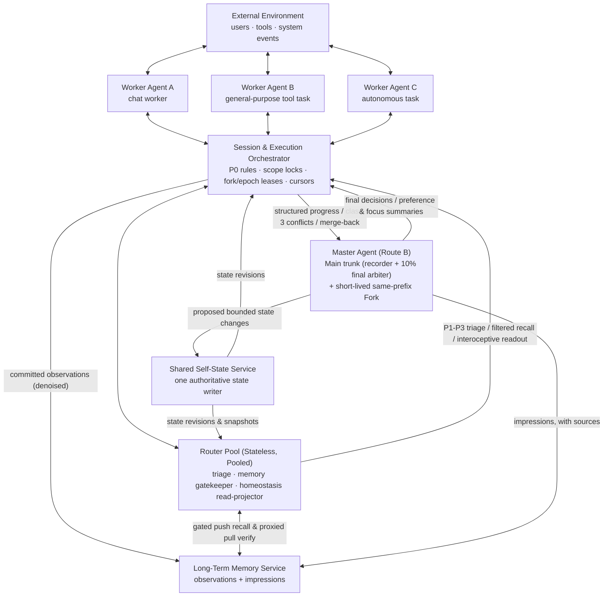
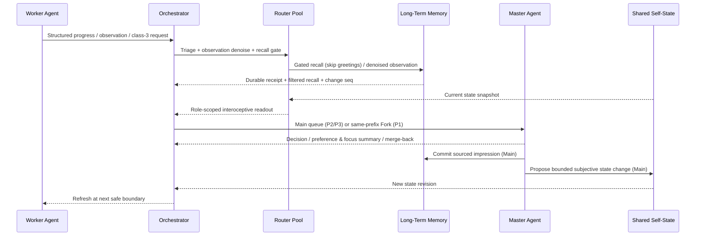

# Master–Worker 持续性认知与双通道记忆架构提案

> Status: **PROPOSAL / NOT IMPLEMENTED**  
> Version: v0.3  
> Date: 2026-11-17（Updated: 2026-11-20）  
> Base: `cleanup/resident-memory-only`  
> Scope: 研究性架构设计；**本提案不构成已实现、已部署或通过生产验收的声明**。以本版（v0.3）与最新修订的运行机制记录为准。

后续运行机制细化见：[运行机制讨论记录：观察、决策、路由、分叉与上下文换代（2026-11-20 修订）](master-worker-runtime-discussion-20261117.md)。

**P0 模型候选决定（2026-11-17）**：首先将 `Qwen/Qwen3.5-9B-Base` 作为 Master 的原始预训练基线，先测再决定后训练方案；暂不部署或替换现有运行时。详见 [Qwen3.5-9B-Base Master baseline 实验方案](master-qwen35-9b-base-baseline-20261117.md)。

## 0. 摘要

提议以 **一个持久主体（Persistent AI Agent）+ 多个 Worker Agent + 一个 Master Agent + 一个池化无状态 Router 层** 的形式组织长期运行的智能体。

- **Worker（外部交互代理）**：具有部分自主权，可在任务范围内自行判断和推进，与用户、工具、环境交互；记录可追溯的**外部观察、消息来源、工具尝试和确认结果**。局部技术/步骤冲突由 Worker 自行解决；仅涉及主体核心偏好、重要承诺或明显方向背离的重大决策，才进入 Master 终审范围。Worker 不直接写入权威自我状态，也不将推测升级为客观事实。
- **Master（主体反思与记录核心 + 极低频重大价值终审，路线 B）**：常态下以**记录与反思**为主（约 90% 工作负载），基于结构化进展、动作草案、关键工具结果与思考摘要（**不读取原始 CoT**），生成**心声摘要、主观印象、评价、待检验假设、状态变更建议**，并维护只读的偏好摘要与关注焦点；仅在极低频的第 3 类冲突（主体核心偏好、重要承诺、明显方向背离或跨会话意图相悖）时行使内部终审裁决权。Master 不是事实仲裁者，且不可绕过外部工具授权、安全审批与隐私边界。
- **Router Pool（池化无状态模型池 / 网关层）**：隶属编排控制面的轻量计算池，采用**单次任务级无状态（用完即销毁）**模式，共享底层小模型池但在逻辑上拆分为四类子职责：入口调度与首轮离散优先级定级（配合确定性硬规则）、记忆自动预召回门控与按需查证代理、内稳态按角色分级读向投影、以及仅限客观观察去噪/物理负荷提取的写入辅助。Router 不演化独立人格，也不替代 Master 的主观印象写入与意义型情绪评估。
- **Shared Self-State Service（共享主体状态服务）**：唯一拥有持久身份、当前情绪/需要、动机与当前意图的状态写入权；按版本串行应用经约束的状态变更（含确定性客观资源/负荷更新与 Master 提交的有界主观评估建议）。
- **Long-Term Memory Service（长期记忆服务）**：统一保管带来源的外部观察与内部印象，提供检索、修订、撤销、依赖失效及增量变更信息。它是**记忆记录的权威来源**，不是外部世界真相的最终裁判。
- **Session & Execution Orchestrator（会话与执行编排器）**：管理多个并发会话、工具执行、变更游标、作用域互斥锁、Master 临时分叉事务（Fork）、Epoch 租约换代、上下文刷新及行动前的依赖检查。

目标是让不同会话有各自的短期工作上下文，但它们共享一个主体状态和一条可追溯的经历时间线。该方案**不声称**实现或证明主观意识；可验证的是持续身份、自我建模、状态因果性和跨会话一致性。

## 1. 命名与职责

对外展示的架构图只使用通用术语，不要求读者了解任何现有工程名称。

| 通用组件 | 主要输入 | 主要输出 | 不承担的职责 |
| --- | --- | --- | --- |
| Worker Agent | 用户消息、工具反馈、经门控召回的记忆、角色分级状态提示、Master 裁决 | 局部自主决策、第 3 类冲突终审请求、结构化进展/动作草案/思考摘要、观察事件、外部回复/动作 | 独立永久人格；全局情绪写入；自行升级事实/版本冲突给 Master 裁决 |
| Router Pool（编排网关子层） | 入站事件、只读关注焦点摘要、客观状态快照、记忆检索/读取请求 | 入口首轮离散优先级（P1/P2/P3）、创建 Worker 指令、记忆 `SKIP/RECALL` 门控与裁剪结果、角色分级内稳态读向转写、客观观察去噪结构化 | 长期上下文状态；独立人格；P0 安全硬规则替代；主观印象写入与意义型内稳态评估；剥夺 Master 主动查证权 |
| Master Agent | 结构化进展与摘要、第 3 类冲突终审请求、已提交观察、既有印象、客观内感读数、时间差 | 带个人色彩的评价/印象/心声、状态变更建议、极低频终审裁决、只读偏好与关注焦点摘要、日记与复盘 | 事实/版本最终裁决；局部技术细节介入；直接绕过外部工具授权与隐私边界 |
| Shared Self-State Service | 客观负荷/节奏事件、Master 提交的有界状态变更建议 | 带 revision 的全局状态快照、状态变更记录 | 长期原文检索；工具执行 |
| Long-Term Memory Service | 观察事件、印象、修订/撤销命令、经网关校验的检索请求 | 持久回执、记录版本、检索结果、变更游标 | 声称所有记忆均是客观真相；替调用方决定“是否应该查记忆” |
| Session & Execution Orchestrator | 多会话事件、硬规则信号、服务回执及订阅变化 | P0 硬规则直判、作用域锁与 Fork 事务编排、Epoch 租约换代、上下文刷新、依赖失效拦截 | 第二份独立记忆/主体 |

**单一主体原则**：`character_id` 唯一标识持续存在的主体；`session_id`、`conversation_id`、`worker_id`、`fork_id`、`epoch_id` 仅标识任务、短期快照或上下文代际，绝不衍生第二份长期人格。

## 2. 总体拓扑



这里的“心声”是由 Master 生成的**内部评价记录**，而不是必须对外发送的文字，也不是无限制保存的原始隐式推理过程。应保存可说明来源、可修正的简短反思，而非无界的 token 日志。

## 3. 双通道记忆与认识论边界

### 3.1 外部观察（Observation / Evidence）

Worker 在外部观察通道中只能记录**发生了什么或收到什么声明**，并携带证据来源；这不限制其在任务内进行局部判断与规划。例如：

- “用户在消息 `msg-123` 中表示自己今天很累”——可验证的消息事件；
- “用户一定很累”——不是同一层级的客观事实，应保留为用户陈述；
- “工具返回成功状态和回执 `receipt-456`”——有证据的执行结果；
- “模型计划发送消息”——计划或尝试，**不是**已经发送。

Worker 必须区分 `user_statement`、`tool_attempt`、`tool_result`、`delivery_receipt`、`environment_observation` 等来源；没有执行回执不得将外部副作用标为成功。

### 3.2 主观印象（Impression / Appraisal）

Master 基于已提交事件及当前状态形成**可修订的认识**，例如：

- “用户可能需要减少打扰”，附来源记录和置信度；
- “我对当前研究方向感到好奇”，作为内在状态的语言化解释；
- “先完成当前任务再主动联系更合适”，作为策略建议。

主观印象不是外部事实，不得因被多次检索、重述或摘要而提升证据等级。

**禁止自证循环**：同一个印象导致某种 Worker 行为后，该行为产生的“缺少回应”不能独立证实最初的印象。不同类型证据的权重、来源独立性和反证应被显式记录。

### 3.3 来源与修订

每条记忆最少关联：`character_id`、`source_instance`、`event_id`、`occurred_at`、`observed_at`、`source_ids`、`kind`、`content`、`revision`（持久化后）、`privacy_scope`。具体字段是否已有对应契约，应在实施时依当前 schema 核对，不应凭本提案增删数据库列。

- 旧印象修订后保留其历史版本；
- 来源撤回、更正时，其派生印象应失效或进入待重新评价状态；
- 具有不同观察时间的事实不能简单按最后一条写入替换；
- 记忆服务的在线摘要和索引不可作为脱离原证据的独立新事实。

## 4. 跨会话一致性：同一主体，不同上下文

一次模型调用消费**有版本的认知快照**：

```json
{
  "character_id": "agent-1",
  "session_id": "session-B",
  "memory_cursor": 1052,
  "state_revision": 287,
  "persona_revision": 8,
  "relevant_record_revisions": {
    "record-training-policy": 3
  },
  "local_context_ref": "session-B/context",
  "pending_invalidations": []
}
```

该结构是**建议的运行时协议**，并非当前 HTTP API 已经提供的响应。

- `memory_cursor`：该会话已处理的长期记忆变更水位；
- `state_revision`：读取的主体状态版本；
- `persona_revision`：当前人格配置版本；
- `relevant_record_revisions`：会直接影响当前任务的具体事实版本。
  
它们形成跨服务的**版本依赖集合**，并非声称跨两个 SQLite 服务已经存在原子一致快照。

### 4.1 变更传播原则

1. Worker A 将观察事件写入持久 outbox；记忆服务确认 `DURABLE` 后才视为已经提交。
2. 编排器持续消费记忆服务变更流 `/v1/changes?after=<cursor>`，并保存自身消费水位。
3. 变更包含 `record_id` / `revision` / `operation`；消费者判断哪些 Worker 正在依赖相关记录。
4. **普通相关变更**：标记待刷新，在下一个推理/工具边界重新读取。
5. **影响行动正确性、授权或安全的变更**：在下一次受影响的不可逆动作前阻止旧计划继续执行，要求重读证据和重新规划。
6. 与当前任务无关的变更不要求立即唤醒所有 Worker。

不能把“写入 outbox”“消息已收到”“检索缓存存在”与“长期记忆已持久提交并被其他会话观察到”等同。

### 4.2 实例：改变研究计划

- Worker A 接收到用户决策：“第一阶段只做 SFT，不开展 DPO”；
- 该决策带消息来源入库，产生 `seq=1052`；
- Worker B 正准备执行依赖旧 DPO 计划的训练命令；
- B 的记录依赖还停在 `revision=2`，编排器发现该记录已更正为 `revision=3`；
- B 在执行前重新规划，停止尚未执行的旧步骤；
- 已实际发生的外部动作不会因为计划变更而被“撤销为未发生”。

### 4.3 缓存与事实更正

普通问答可容忍有界延迟刷新；关键决策应使用已确认的新版本或主动验证具体 `record_id` 的最新修订。不得用仅依据 TTL 的检索缓存来保证严格的最新性。

## 5. Master、Router 与并发控制机制（v0.3 定案）

Master 以**反思与记录为核心（常态约 90%）**，同时保留**极低频重大价值/方向终审权（约 10%，路线 B）**；内部裁量权不意味着可绕过外部工具授权、安全审批、隐私范围或事实核验，也不意味着对所有状态字段拥有无条件写入权限。

### 5.1 路线 B：三类冲突分流与“一次异议 / 新事实”协议

将运行时冲突明确分为三类，仅第 3 类允许进入 Master 队列：

| 冲突类别 | 典型场景 | 处理归属 | Master 介入方式 |
| --- | --- | --- | --- |
| **1. 事实 / 版本 / 资源冲突** | 计划修订（`revision 2 → 3`）、记忆 `CONFLICT`、文件/通道互斥 | **Orchestrator**（依版本与依赖拦截重规划）+ **Worker**（查证或向用户核实） | 不作同步裁决；仅事后异步记录 |
| **2. 任务内局部技术 / 策略冲突** | 编码实现选型、工具重试路径、普通局部步骤 | **Worker 自主决策**；越权或不可逆外部动作走确定性审批找用户 | 不进入 Master 队列 |
| **3. 主体偏好 / 价值 / 意图冲突** | 重大偏好取舍、重要承诺、明显方向背离、跨会话意图相悖 | **Master 内部终审**（含纠偏与终止 Worker） | 极低频高优终审（P1/P0） |

**内部控制权与外部边界统一**：在架构内部的意图与决策链上，Master 对 Worker 拥有最终控制权；Worker 在**同一条冲突中只有一次异议机会**，Master 听取后仍坚持原决定时 Worker 无条件服从。但 Master 的裁决仍严格受既有外部工具授权、敏感动作审批、隐私边界及事实证据规则约束，不可越权执行。

**一次异议 vs. 新事实的确定性校验**：每次决策分配唯一 `decision_id` 并固化其依赖的 `evidence_set`（`record_id + revision` 集合）。只有在长期记忆或观察流中出现了**不在原 `evidence_set` 内的新 `committed observation` 或更新后的 `revision`** 时，协议层才放行“新事实重提”；否则视为同一冲突，强制执行一次异议上限。

### 5.2 观察输入源与带个人色彩的评价

**放弃读取原始 CoT**。受限于商业模型接口能力、上下文清洁度要求及防过度思考原则，Master 对 Worker 的常规观察输入统一改为四类结构化信号：

1. **结构化进展**（关键节点与当前任务状态）；
2. **拟执行动作草案**（重要或受依赖约束的下一步计划）；
3. **关键工具结果与回执**（已确认的事实与错误）；
4. **思考摘要**（若有模型或协议层提供的精简推理摘要，不冒充原始 CoT）。

评价与记录带有 Master 所采用语言模型和提示词形成的个人色彩，但外部观察与主观评价严格分离，不得将主观解释自动提升为外部事实。

### 5.3 Router Pool：无状态模型池、记忆门控、内稳态投影与四档优先级

Router 采用**计算资源池化 + 单次任务级无状态（用完即销毁）**模式，避免跨话题串味及演化出第二份人格；所需短时状态（如最近数轮摘要、当前已注入 `record_id` 集合、事件防抖计数）由 Orchestrator 在调用外部确定性维护并作为输入传入。

运行时共享底层小模型池，逻辑上拆分为清晰子职责：

1. **记忆调用统一上收（`MemoryGatekeeper`）**：
   - **自动预召回（Push）前置门控**：在调用 NeuralCloud `/v1/recall` 前先做 `SKIP / RECALL` 判定（拦截纯寒暄/问好触发无效全量问好召回），对需检索请求做结构化 query 改写、已注入去重、隐私域过滤与字节预算裁剪。
   - **主动按需查证（Pull）代理**：保留 Master（及受控 Worker）主动发起 `memory_recall` / `memory_read` 的能力，避免认知盲区；所有主动调用同样经过网关做权限过滤、预算裁剪与 `relevant_record_revisions` 依赖登记。
2. **内稳态读向投影（`HomeostasisProjector`）**：
   - **确认需要读向投影**，且必须按消费角色分级输出只读视图：
     - **给 Master**：高保真、低修辞的**客观内感读数**（结构化规则/模板优先，附数值、偏离度、趋势与版本），由 Master 自行赋予主观色彩；
     - **给 Chat Worker**：精简的**基调与精力约束提示**（配合 Master 维护的只读偏好摘要）；
     - **给 General-purpose Worker**：默认**不注入情绪转写**，仅在必要时传入硬性资源/节流约束，避免上下文污染。
3. **写入侧严格边界（不替代 Master）**：
   - Router 池最多承担**外部观察通道的去噪与结构化**（不带主观推断、保留 `evidence_ref`）以及**客观运行负荷/资源特征提取**；
   - **严禁**替 Master 写入主观印象通道（`impression`）或执行意义依赖型的内稳态情绪评估。
4. **三层离散优先级裁定（`DispatchRouter`）**：
   - 采用 **确定性硬规则托底 P0 + Router 结合只读“主体关注焦点摘要”初定 P1/P2/P3 + Master 事后重排权**，并由 Orchestrator 提供 **deadline 到期提权**与 **Aging 防饥饿**。Router 仅在首次入队时定级，不反复重排队列。

| 优先级档位 | 语义边界 | 裁定主体 | 运行时行为 |
| --- | --- | --- | --- |
| **P0（紧急止损）** | 用户急停、不可逆危险动作拦截、系统安全边界 | **确定性硬规则**（不经 LLM） | 立即生效（阻断 Worker / 作废同域在途旧生成 / 紧急处置） |
| **P1（高优终审）** | 触及主体重大偏好/承诺且时效敏感的第 3 类冲突、到期关键 deadline | **硬规则初筛 + Router 语义确认** | 主干空闲直接处理；主干正忙非冲突任务（或低优同域任务）→ **允许触发 `Master-Fork`** |
| **P2（中优常规）** | 重要任务进展、非紧迫的硬性等待、常规待决策/待执行备忘录 | **Router 首轮定级**（Master 可重排） | 进入主干优先级队列顺次处理；**不触发 Fork，不打断主干** |
| **P3（低优背景）** | 例行归档、非紧急复盘、写日记、长期整理与 dreaming 候选 | **默认归类 + Router 分流** | 主干空闲时消化；受 deadline 到期提权与 Aging 防饥饿约束 |

> Worker 申报 `hard_wait=true` 仅代表其自身冻结受影响步骤的等待义务，是入队定级的输入特征，不自动等同于 P1。

### 5.4 同前缀临时 Fork 事务与 Epoch 租约换代

#### 1. 临时同前缀 Fork Master（解决低频高优插队而不中断主干）

当主干 `Master-Main` 正在处理低优/非冲突任务，而新的 **P0 / P1** 终审事件到来时，不粗暴取消主干生成，而是派生一个短命的同源分叉 `Master-Fork` 独立裁决，受 **4 条硬约束**保护：

1. **严格写权限限定 + 创建期退出门禁（Exit Gate）**：`Master-Fork` 仅允许输出针对目标 `decision_id` 的裁决与依据，禁止修改偏好摘要、优先级表、日记或直接写入长期印象与状态变更。创建时固化退出门禁条件（结构化校验通过 + 裁决已落盘进入 Worker 下发通道 + 回注记录已入主干队列，或触发硬超时/显式失败回滚），**确认全部门禁完结后方释放锁并销毁**。
2. **作用域互斥与同域排队**：
   - 若主干正忙其他作用域，直接锁定目标 `scope_key` 派生 1 个 Fork；
   - 若主干当前恰好在目标 `scope_key` 上执行**低优在途生成**，可将主干该笔输出标为 `SUPERSEDED`（不强杀流，返回时丢弃不下发），立即派生 1 个 Fork 优先处理最高优事件 `E1`；
   - **同一作用域严禁并发多个 Fork**：若 `E1` 尚在裁决中而同域继续涌入 `E2`、`E3`，后续事件进入该作用域等待队列，待 `E1` 通过退出门禁释放锁后连同 `E1` 结果合并顺次处理；作用域锁配硬超时 TTL 回收，杜绝死锁。
3. **无中断强制回注主干（Merge-Back Barrier）**：Fork 裁决生效后将 `fork_decision_committed` 写入主干输入队头，**不中断主干当前生成**；等主干自然轮次结束后，在下一轮 Append-only 搭便车注入，保持前缀缓存完整并由主干统一补记印象、复盘与内稳态建议。
4. **纯 Append-only 复用前缀**：Fork 严格复刻 `Master-Main` 上一次已稳定落盘的精确消息前缀（前文零改动），仅在末尾追加紧急裁决包，最大化命中本地或云端 Prefix Cache。

#### 2. Epoch 租约换代与参数化上下文水位（本地 ↔ 云端回迁）

- **基于标签的上下文瘦身 + Epoch 租约切换**：
  1. 主干 `Master-Epoch-N` 触及换代阈值时，冻结快照点的分段标签清单；
  2. 启动**只读候选准备者（`Candidate-Epoch-(N+1)`，无决策权、无写权）**，依据标签（必要时按需展开个别原文）选出保留清单，剔除不重要的已完结历史，组装出干净紧凑的新上下文并标为 `ready`；
  3. 等原主干当前单步安全落盘后，Orchestrator 短暂缓冲新事件，将准备期产生的极少量增量段追加至新上下文尾部，**原子切换主干写租约至 `Epoch-(N+1)`**；
  4. 旧 Epoch 立即失权归档，待后续 dreaming 整理完跨任务关联后清除不再使用的旧记录。
- **参数化水位与 1M 云端预留**：将日常活跃工作水位与换代触发阈值配置化，确保整套换代闭环在**本地较小窗口**即可稳定运行；1M 上下文定位为后续对接 Kimi K3 等云端大窗 API 的能力预留，当本地模型不可用时可直接复用 **Epoch 换代协议**平滑回迁至云端模型，仅调整水位配置即可双向适配。

### 5.5 主体状态提交

建议的控制流程：



状态所有者对并发写入实行单一串行顺序，并要求在依赖旧快照计算的情况下按版本检查、必要时重新求值。客观资源/负荷类变化可由状态服务规则（配合客观负荷事件）直接驱动，意义依赖型主观评估建议保留给 Master 主干提交。不可采用 Worker A、B 直接对同一个 JSON 状态文件做“最后写入者覆盖”。

**情绪数值**是工程上可观察的内在状态变量，不等于主观体验的测量结果；语言化心声应与实际状态、证据和决策关联，避免训练模型单纯学会“宣称自己有情绪”。

## 6. 建议的数据契约（草案，不代表已实现）

### 6.1 Worker 外部观察

```json
{
  "schema_version": 1,
  "character_id": "agent-1",
  "source_instance": "worker-A",
  "event_id": "message-123",
  "session_id": "session-A",
  "kind": "user_statement",
  "occurred_at": "2026-11-17T01:00:00Z",
  "content": "用户表示今天很疲惫，打算早点休息",
  "evidence_ref": "channel-message-123",
  "privacy_scope": "private"
}
```

### 6.2 Master 主观印象

```json
{
  "schema_version": 1,
  "character_id": "agent-1",
  "source_instance": "master",
  "event_id": "impression-456",
  "kind": "impression",
  "source_ids": ["observation-record-123"],
  "content": "用户可能希望今晚减少主动联系",
  "confidence": 0.75,
  "status": "tentative",
  "privacy_scope": "private"
}
```

示例中的字段体现期望语义。实际写入须经过现有 `SourceEvent` / `SourceEventV2` 契约映射，不能假定当前接口直接接收上述 JSON。

### 6.3 Master 状态建议

```json
{
  "character_id": "agent-1",
  "expected_state_revision": 287,
  "cause_record_ids": ["observation-record-123"],
  "change": {
    "social_outreach_priority_delta": -0.1
  },
  "reason": "减少打扰的暂时策略建议"
}
```

这不是外部事实，也不应凭空提升为新的权限设置。状态服务将根据已有事实、版本和预算/权限契约决定是否采纳。

### 6.4 冲突决策与“一次异议 / 新事实”记录

```json
{
  "decision_id": "dec-20261120-001",
  "conflict_class": "CLASS_3_VALUE_PREFERENCE",
  "scope_key": "worker:chat-private-1",
  "evidence_set": [
    { "record_id": "rec-1052", "revision": 3 }
  ],
  "objection_count": 0,
  "max_objections": 1,
  "hard_wait": true,
  "priority": "P1",
  "status": "OPEN"
}
```

仅当提交的观察或记忆修订包含不在 `evidence_set` 内的新 `(record_id, revision)` 时，允许按“新事实”重置或新开裁决；否则受 `max_objections = 1` 约束。

### 6.5 临时 Fork 事务契约（`ForkContract`）

```json
{
  "fork_id": "fork-20261120-001",
  "parent_epoch": 12,
  "prefix_hash": "sha256:...",
  "scope_key": "worker:chat-private-1",
  "decision_id": "dec-20261120-001",
  "priority": "P1",
  "allowed_outputs": ["DECISION_ONLY"],
  "ttl_ms": 15000,
  "exit_gate": {
    "schema_valid": false,
    "worker_outbox_committed": false,
    "main_merge_back_enqueued": false
  }
}
```

### 6.6 记忆门控判定（`RecallGateDecision`）

```json
{
  "event_id": "message-124",
  "consumer_role": "CHAT_WORKER",
  "action": "SKIP",
  "reason": "pure_greeting_no_memory_dependency",
  "rewritten_query": null,
  "privacy_scope": "private",
  "max_bytes": 8192
}
```

## 7. 现有实现可复用的边界（核对日期：2026-11-17）

从现存分支代码可确认：

- Long-Term Memory 侧已有 SQLite WAL、单实例所有权、`/v1/ingest`、`/v1/recall`、`/v1/records/{record_id}`、`/v1/corrections`、`/v1/receipts`、`/v1/changes` 等接口；变更流按 `seq` 返回记录修订，修订可使依赖来源失效。
- 已有 Harness 记忆薄插件包含持久 outbox、会话持久化屏障、按会话的事件游标，以及短时检索缓存。
- 现有 Shared Self-State 侧已有带 `revision` 的全局状态和事件反馈通道；外部可证实的观察与模型自我评价已有初步区分。
- 历史实施方案已经规定：单一 `character_id`、全局授权记忆、唯一状态所有者、会话不创建第二份人格。

**缺口（拟实施）**：跨会话消费者订阅记忆更正、按依赖记录定位受影响 Worker、关键动作前重新验证、池化无状态 Router（记忆门控 / 内稳态读向投影 / P1-P3 初定级）、同前缀 Fork 事务与 Epoch 租约换代、Master 印象语义契约及其与状态服务的集成。不能将“API 已存在”写成“完整跨会话认知同步已经实现”。

注意：文档仓库最近保存了生产源码恢复快照，但不能替代运行态和完整生产联调验证。本提案不主动执行生产改动。

## 8. MVP 与验收

采用单机、单主体、两个 Worker、一个 Master（含同前缀 Fork 与 Epoch 换代）、一个池化无状态 Router、一个记忆服务、一个状态所有者。先用合成事件和假工具验证；不引入 Kafka/Redis，不额外搭建一份记忆数据库。

| 阶段 | 交付物 | 最小验收 |
| --- | --- | --- |
| P0 研究基线 | 固定样例、事件契约、误差与冲突基准 | 可从事件日志稳定复现同一结果 |
| P1 双通道写入与门控 | Worker 观察 / Master 印象、来源绑定、Router 记忆门控 | 同一事件重试不重复；纯问好触发 `SKIP` 零召回；印象不自动变成事实 |
| P2 跨会话刷新与冲突分流 | 变更游标消费、任务依赖、三类冲突分流、一次异议校验 | A 更正后 B 重评；第 1/2 类冲突不进入 Master；同冲突第二次无新证据异议被拦截 |
| P3 状态提交与并发控制 | 单写者状态更新、P0-P3 队列、Fork 退出门禁与 Epoch 换代 | 并发反馈不覆盖；Fork 不中断主干且强制回注；Epoch 切换完成瘦身且零漏增量 |
| P4 Master 学习实验 | 训练前后基线 + 消融测试 | 更高的自我预测/情绪因果性，且不增加无依据断言 |

核心测试场景：

1. **纠正传播**：A 修订事实，B 在执行依赖旧事实的工具前重新评估。
2. **隔离**：A 私聊得到的敏感观察可进入内部认知，但 C 群聊不可未经授权对外披露。
3. **竞争写入**：A、B 同时产生事件，记忆与状态版本一致且不覆盖。
4. **重复投递**：同一 `source_instance + event_id` 不得重复产生记忆/状态效果；同 ID 不同内容明确报错。
5. **主观与事实分离**：Master 的猜想不会自动被其他 Worker 表述为已证实事实。
6. **来源更正**：更正观察后关联印象标记失效或进入重新评价，不残留旧结论作为现行证据。
7. **重启恢复**：继续使用持久消费游标，不遗漏已提交变更，也不重放不明外部副作用。
8. **独立证据**：Master 对未收到回复的印象不能靠自己减少主动联系而循环加强。
9. **记忆门控去噪**：用户输入纯寒暄/问好时，Router 判定 `SKIP`，不触发历史问好全量召回；主干/Worker 主动按需查证通道仍受隐私与预算网关保护。
10. **Fork 门禁与同域排队**：主干处理非冲突任务或低优同域任务时，P1 冲突派生单个同前缀 Fork（必要时标主干低优输出为 `SUPERSEDED`），同域后续紧急事件排队合并处理；未满足退出门禁不销毁，完结后无中断回注主干。
11. **Epoch 换代与回迁**：主干触及水位阈值后，只读候选按标签剔除不重要历史并组装紧凑上下文，切租约时补齐准备期增量不丢消息；模拟本地模型不可用时可通过 Epoch 换代平滑回迁至云端大窗 API。

评价指标建议：跨会话陈旧事实使用率、事实归属正确率、印象修订成功率、无证据断言率、重复副作用数、状态版本冲突率、无关会话误唤醒率、无效问好召回拦截率、Fork 前缀缓存命中率、Epoch 瘦身压缩比。真实基线和阈值应由首轮实验测量，不预先填写“已通过”。

## 9. 实施纪律与非目标

- 本文是架构提案与编码前规格基线；尚未宣称已实现、已部署或通过线上验证，不直接修改生产部署、线上数据与凭据。
- 不采用非必要的防御性编程掩盖契约缺陷。无法恢复的不变量违例直接报错；持久化、权限与外部副作用边界需要明确、有限的保护。
- 不为“持续存在”而强制 LLM 24 小时持续生成 token；持续性由状态、记忆和有界事件循环保证。
- 明确放弃读取原始 CoT；不记录、跨会话传输或展示未经筛选的内部推理链，仅使用结构化进展、动作草案、关键工具结果与思考摘要，并保存有来源、有意义、可撤回的评价摘要。
- 不因 Master 的内部终审裁决绕过既有外部工具权限、敏感动作审批及隐私范围。
- 不把模拟中的情绪、自我评价或行为连续性当成主观意识已被证明的证据。
- 与实际系统集成前，再核对运行源码、当前契约、备份及恢复门禁；不使用 GitHub 分支替代生产基线。

## 10. 对现有仓库的实现映射（仅供维护者）

上述通用图中：

| 通用术语 | 现有工程中的对应职责 |
| --- | --- |
| Long-Term Memory Service | NeuralCloud（保留现有 Python 服务，经 `/v1/*` HTTP 契约对接） |
| Shared Self-State Service | MistyAI 的常驻 persona/state 组件（或对应单写者状态服务） |
| Session & Execution Orchestrator | 新架构 Java 控制面核心（事件循环、P0 硬规则、作用域锁、Fork/Epoch 租约、依赖检查） |
| Router Pool | 新架构 Java 控制面内的池化无状态模型池与网关层（入口初定级、记忆门控、内稳态读向投影） |
| Master Agent | 待研发的主体反思/记录与低频终审组件（本地候选基线见 `Qwen3.5-9B-Base`，预留云端大窗 API 回迁） |
| Worker Agent | 与用户、工具和环境交互的执行会话（Chat Worker / General-purpose Worker） |

映射只是集成定位，不要求把 Master 或控制面实装到 NeuralCloud 中。**记忆权威和认知执行应保持职责分离**。

### 10.1 新架构的实现语言方向

新架构以 **Java 作为控制面与编排层的主要实现语言方向**（承载 Orchestrator、Router 池、优先级队列、作用域锁、Fork 事务与 Epoch 租约状态机），并通过稳定 HTTP 契约复用现有 Python 版 NeuralCloud 长期记忆服务；模型评测与训练相关脚本保留 Python。该选择不改变各组件的认知职责和记忆边界。

## 11. 开放研究问题

1. Master 的“心声”应在什么情况下写入长期记忆，何时只保留为短期状态？采用固定预算还是事件价值筛选？
2. 对同一来源的多个印象，如何衡量真正独立的证据增量并避免自我强化？
3. Master 与 Worker 是否使用同一底模、不同 LoRA adapter，还是独立小模型？应通过受控对照测试选择。
4. 状态编码器怎样利用跨会话时间序列训练，才能优于角色 SFT 和静态记忆提示词？
5. 当新证据挑战已有印象时，怎样兼顾主体连续性与可信的自我修正？

后续按讨论进度逐项细化，尚未讨论的边界保持开放。P0 的**合成双会话事件测试与接口映射**仍作为后续实施准备，不立即调整生产模型或记忆数据库。
