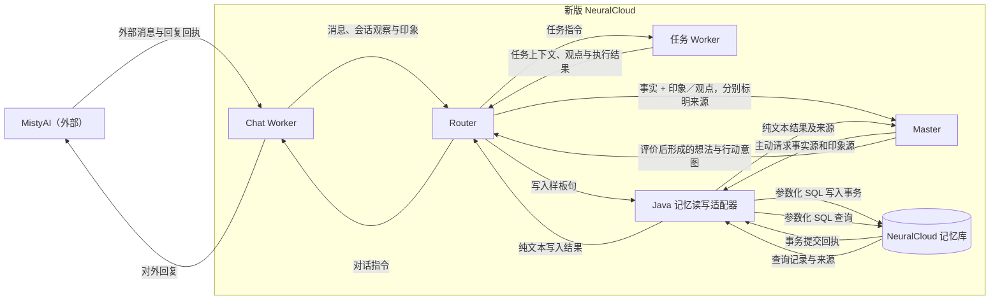

# 新版 NeuralCloud 的 Java 实施方案

2026-11-18 · 计划稿。本版更新 Router 的职责和数据流，沿用[总体提案](master-worker-cognitive-architecture-20261117.md)中的单一主体与双通道记忆设计。设计背景见[运行机制讨论](master-worker-runtime-discussion-20261117.md)，开发遵循[项目守则](../../AGENTS.md)。

## 1. 系统边界与数据流

MistyAI 是唯一外部系统。按本版方案，外部对话由 Chat Worker 接收和回复；新版 NeuralCloud 内部由 Router 整理各 Worker 的上下文，并把 Master 的意图拆解为各 Worker 能执行的指令。

**Worker → Router。** Worker 提供本轮相关的消息、观察、判断及动作结果。Router 过滤无关上下文，保留理解当前问题所需的原文引用、来源、发生顺序和更正关系。

**Router → 记忆模块、Master。** 整理后的事实可以直接提交记忆，无须等待 Master 批准。同一批次中，事实与印象／观点都要交给 Master 评价，并标明各自的性质、提出者和所依据的记录。例如，“用户在消息 B 中将时间改为周六 10:00”是有来源的事实；“用户可能担心旧提醒仍然有效”是 Worker 的印象。后者跟随事实进入评价流程，保留其推测身份。Router 负责整理，Master 负责判断这些材料意味着什么。

**Master → Router → 各 Worker。** Master 给出目标、决定和必要约束。Router 按目标拆出具体动作，为每条指令选择负责的 Worker，并注明执行所需的依据和先后关系。Worker 将执行结果送回 Router；Router 可将有回执的结果写入记忆，并把新的事实和观点交回 Master。

### 1.1 角色之间只传自然语言正文

Worker 的上报、Router 的整理与派单、Master 的评价与意图，以及 Worker 的结果反馈，均使用人能直接读懂的纯文本句子。正文可以使用阿拉伯数字，例如“11 月 18 日 09:10”“第 2 条消息”和“共 3 项任务”。JSON、XML、YAML、键值表、函数调用、命令和源代码均不进入角色上下文，包括作为引文、代码块或转义字符串嵌入正文的情形。此约束同样适用于 MistyAI 输入、工具反馈和记忆召回进入任一角色上下文的时刻。

Java 在构造上下文之前分离正文与技术数据。发送者、接收者、会话、原始证据引用、版本和回执标识由运行时关联。正文需要交代依据时，用“根据用户今天的第 2 条消息”这样的来源描述。原始材料含代码时，上下文只接收与当前任务有关、已有依据的文字说明；只有代码而没有可用说明时，只报告“该消息附有代码”。记忆读写适配器在模型上下文之外完成样板句与现有服务契约的映射，HTTP 请求体、原始响应和异常栈止于适配器。

### 1.2 角色可见的检索请求、写入和返回句式

下表是首版建议样板。中文书名号标出的部分是待填内容；实际通信只呈现填好的句子。时间取自对应消息、评价或动作回执，陈述的发生时间与陈述中提到的计划时间分别保留。

| 记录类型 | 写入样板 | Master 调用记忆读写适配器 的请求样板 |
| --- | --- | --- |
| 发言 | 《说话人》在《发言时间》说：“《发言内容》”。 | 请查找《说话人》在《时间范围》关于《主题》的发言。 |
| 更正 | 《说话人》在《发言时间》将《事项》从《旧内容》更正为《新内容》。 | 请查找《事项》截至《时间》的最近一次更正。 |
| 印象 | 《提出者》在《评价时间》对《事项》的印象是《判断》，依据是《来源说明》。 | 请查找《时间范围》内关于《事项》的印象及其依据。 |
| 主体态度 | 我在《评价时间》对《对象》的态度是《态度》，依据是《来源说明》。 | 请查找我在《时间范围》对《对象》的态度。 |
| 动作结果 | 《执行者》在《完成时间》完成了《事项》，结果是《回执确认的结果》。 | 请查找《执行者》在《时间范围》完成《事项》的结果。 |

Router 可直接写入有来源的发言、更正和已确认结果。主体态度取自 Master 已形成的评价；Worker 的猜测保留提出者，随事实送交 Master。记忆查询命中时按对应记录句式逐条返回，附“来源是《来源说明》。”；无匹配记录时返回“未查到符合条件的记录。”写入获得持久回执后返回“已记录《事项》。”这些句子由适配器按实际结果生成。

### 1.3 Master 主动取证与印象生成

每次 Master 就事项作出评价或决定前，须针对当前问题主动调用记忆读写适配器的检索能力，查询相关的**事实源**和**印象源**。Router 的整理用于确定查询对象、时间范围和线索。两类查询可以合并为一次调用，但各自返回命中记录或无匹配结果。

- **调用方式。** Master 用固定自然语言样板提出查询。Java 执行真实检索，关联本轮调用与返回记录，再将结果按样板句交回 Master。只有执行层可以填入检索结果；模型生成的“已查到”不能作为回执。发往记忆库的查询只使用 SQL。
- **事实归属。** 事实性表述须能追溯到本轮取回的有效来源，且只表达来源能证明的内容。消息证明某人说过什么，动作回执证明该回执确认的结果。没有相应事实源时，Master 可以提出核实请求或说明“目前无法确认”。检索失败与检索成功但无匹配记录分别表述。
- **生成印象。** Master 可以形成新印象，即使没有相似的历史印象。用“根据……，我目前倾向于……”表达依据和主观性。历史印象保留原提出者和依据；它可以帮助解释新情况，但不能单独证明外部事实。若保存新印象，显式记录为 Master 的可修订印象。

### 1.4 统一记忆读写适配器与参数化 SQL

Java 记忆读写适配器统一维护读写样板、SQL 模板和纯文本返回格式。检索时，适配器按约定句式选择固定的只读 SQL 模板，将主题、时间等作为参数绑定，并应用当前主体与可见范围。发往记忆库的是参数化 SQL 查询。适配器将数据库实际返回的事实、印象和来源渲染成自然语言，供 Master 评价。SQL 和原始结果行留在执行层。

写入同样使用参数化 SQL。Router 向 Java 记忆读写适配器提交自然语言样板句，适配器按记录类型选择固定的 SQL 写入模板，将内容、时间和来源作为参数绑定。记忆模块在同一事务内提交记录、来源、版本及对应回执；更正保留与原记录的关联。事务成功提交后，适配器将持久回执转为“已记录《事项》。”返回 Router。

## 2. 用会议改期跑通首条流程

1. MistyAI 将同一会话里的两条消息交给 Chat Worker：“周五 15:00 开会”和“更正，改为周六 10:00”。Java 关联两条消息的标识；Chat Worker 向 Router 转述两条消息，并附上自己的印象“用户可能担心旧提醒仍然有效”。
2. Router 保留消息的更正关系，将两条用户陈述整理为事实样板句，交给记忆读写适配器以参数化 SQL 写入记忆。它把事实和 Chat Worker 的印象一起交给 Master，供 Master 结合“最后定在什么时候开会？”这一问题评价。
3. Master 通过记忆读写适配器 主动查询会议时间的更正记录和关于改期的既有印象。读到更正来源后，Master 形成意图：“请核对提醒清单，并向用户确认最新会议时间；目前只知道用户改了时间。”Router 将核对清单交给具备该能力的任务 Worker，将回复用户交给 Chat Worker。凡回复中要提及核对结果，须先取得该结果。
4. 任务 Worker 将实际核对结果返回 Router。Chat Worker 通过 MistyAI 回复用户；MistyAI 的回执随会话上下文返回 Router。Router 将有来源的执行结果整理入库。用同一会话标识可以串起原始消息、评价材料、Master 意图、各条指令与执行结果。

同一场景中的实际正文示例（时间为示例值）：

| 方向 | 接收方读到的文本 |
| --- | --- |
| Router → 记忆读写适配器 | 用户在 11 月 18 日 09:10 将会议时间从周五 15:00 更正为周六 10:00。 |
| Router → Master | 用户在第 2 条消息中把会议改到了周六 10:00。Chat Worker 认为用户可能担心旧提醒仍然有效；用户没有提及旧提醒。 |
| Master → 记忆读写适配器 | 请查找会议时间截至 11 月 18 日 09:15 的最近一次更正。请查找本次会话期间关于会议改期的印象及其依据。 |
| 记忆读写适配器 → Master | 用户在 11 月 18 日 09:10 将会议时间从周五 15:00 更正为周六 10:00。来源是本次会话中用户的第 2 条消息。未查到符合条件的历史印象。 |
| Master → Router | 请核对旧提醒，并向用户确认最新会议时间。 |
| Router → 任务 Worker | 请核对提醒清单里是否还有周五 15:00 的会议提醒，并告诉我核对结果。 |
| Router → Chat Worker | 请告诉用户，会议已改为周六 10:00。 |

## 3. 后续实施顺序

| 步骤 | 工作内容 | 正常流程的可见结果 |
| --- | --- | --- |
| 1. 接入对话 | 建议采用 Java 21、Maven、单模块。将 MistyAI 的会话消息接入 Chat Worker，将 Worker 的上下文送到 Router。 | Router 能按会话读取两条改期消息和 Worker 的印象。 |
| 2. 接入记忆 | 在同一 Java 记忆读写适配器中，将 Router 的写入请求映射为参数化 SQL 事务，将 Master 的检索请求映射为参数化 SQL 查询。 | 两次发言可追溯，截止时间查询命中对应更正；写入回执和查询结果以纯文本返回。[记忆接口契约](../../contracts/resident/v1/openapi.v1.json) |
| 3. 接入真实 Master | Router 将两类材料交给本地 Qwen3.5-9B-Base 评价，Master 主动调用记忆读写适配器，读取事实源与印象源后向 Router 返回意图。 | 本轮可追溯到真实检索调用、两类查询结果及所引用的更正记录；Master 对旧提醒是否存在保留判断。[模型基线](master-qwen35-9b-base-baseline-20261117.md) |
| 4. 指令分派与结果回流 | Router 将同一意图拆给任务 Worker 和 Chat Worker，收集执行结果，整理回执入库。 | MistyAI 收到正确回复，能追溯每条指令由哪个 Worker 执行及实际结果。 |

首期只要求上述正常流程完整走通一次。方案采用一个 Chat Worker 和一个任务 Worker，以一次正常分工展示多目标派发；边界测试、并发、抢占和恢复等专项验证排在主流程跑通之后。

## 4. 首期启动与实施计划

首期采用一个 Java 进程，由 `app` 包的入口按依赖顺序启动组件。Router 生成带依赖的派单计划，编排器负责实际派发和收集结果。两个 Worker 随进程初始化，等到编排器派单后再处理业务。[编排器职责](master-worker-design-revisions-20261121.md)

| 启动阶段 | 入口负责的工作 | 进入下一阶段的条件 |
| --- | --- | --- |
| 1. 配置与依赖 | 读取首条流程所需配置，建立记忆服务和模型适配器。MistyAI 入口保持关闭。 | 必填配置已校验，必需的记忆和模型接口可用。 |
| 2. Master | 将约 9B 的模型端点及事实、印象查询能力接到 Master。 | Master 已具备调用这两类查询的能力，等待首个事项。 |
| 3. Worker | 初始化一个 Chat Worker 和一个任务 Worker，分别接上回复与核对提醒所需的能力。 | 两个 Worker 都可接受派单。 |
| 4. Router 与编排器 | 组装 Router 的上下文整理和意图拆解能力，再由编排器接通派单计划与两个 Worker。 | 消息能通过 Router 进入编排流程，带前置条件的任务能按依赖执行。 |
| 5. MistyAI 入口 | 开始接收测试会话消息。 | 入口开始接收消息后，记录进程已就绪。 |

任一阶段启动失败时，记录失败阶段及原因，释放已打开的资源并以失败状态退出。

### 实施顺序

1. **敲定首条流程用到的契约。** 确认 MistyAI 消息和回执的会话、消息标识，明确谁执行 SQL、谁提交事务，以及如何把第二条更正消息与记录版本关联起来。明确哪些来源、授权字段用于渲染记忆返回样板句。
2. **搭启动入口，回放一轮对话。** 用显式组装按表中顺序启动组件。用合成输入验证“周五 15 时”和“改为周六 10 时”能按同一会话、正确顺序到达 Router。补一项启动失败时入口保持关闭的检查。
3. **接真实记忆和 Master。** 实际写入原发言和更正，让 Master 查询事实与印象。核对召回中的周六 10 时对应第二条消息，且可见范围随样板句返回。历史印象为空时，记录实际查询结果。
4. **跑通两个 Worker 与 MistyAI 回执。** Router 为核对提醒和回复用户生成派单计划。编排器让任务 Worker 读取测试提醒清单。Chat Worker 通过 MistyAI 测试会话确认周六 10 时，回复若提到提醒核对结果，就要等核对完成。验收时按同一会话追溯消息、记忆版本、两类查询、两项派单和 MistyAI 回复回执，并检查执行结果已持久化。

首版用普通 Java 类和显式组装，包内只添加这条流程实际用到的类型与接口。首条流程通过后，再评估跨会话刷新、重启恢复和模型抢占。按项目守则，在启动顺序、组件边界、等待条件与回执判定处随实现补上注释。
