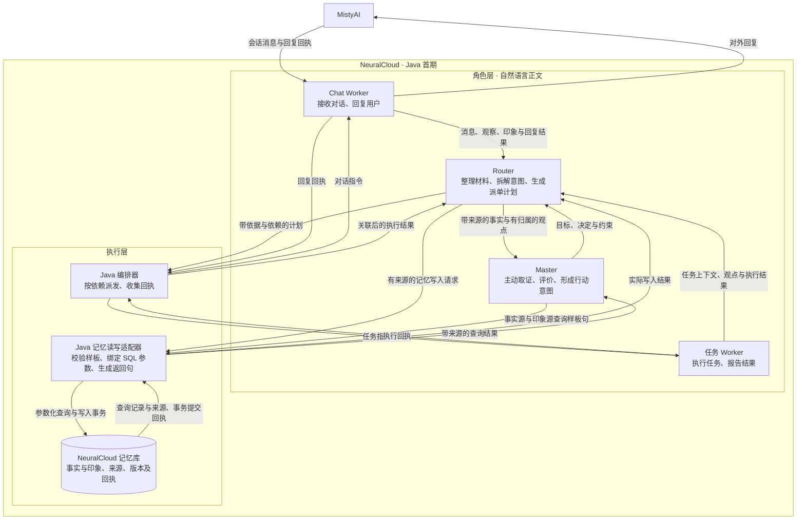
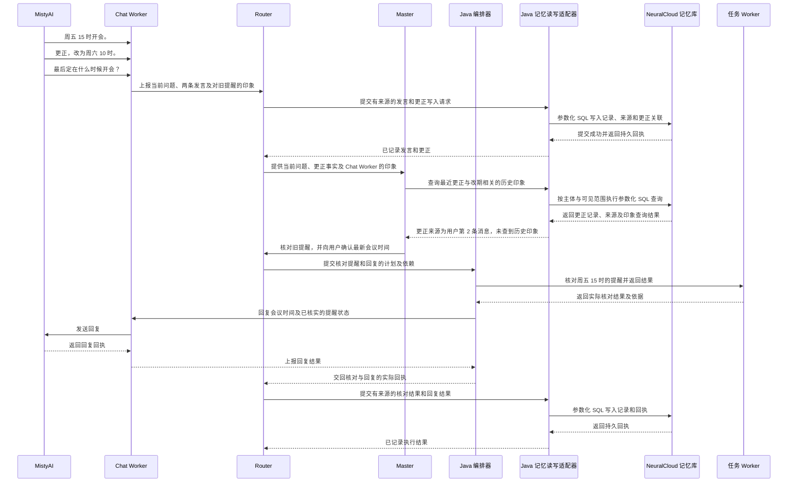

# NeuralCloud Router、Worker 与 Master 软件设计图

2026-11-19 · 首期设计稿。组件职责及实施范围以 [Java 实施方案](master-worker-router-java-implementation-20261118.md) 为准。首期采用单一主体、一个 Master、一个 Chat Worker 和一个任务 Worker，通过会议改期走通对话、取证、派单和回执入库。

## 1. 组件与接口

| 接口 | 契约 |
| --- | --- |
| Worker → Router | 上报当前事项相关的消息、观察、印象或实际执行结果。Router 保留消息顺序、来源和更正关系，印象明确标注提出者及依据。 |
| Router → Master | 同批提供事实与印象。Router 可直接把有来源的发言、更正和已确认结果提交记忆。主体态度取自 Master 的评价。 |
| Master → 记忆读写适配器 | 每次评价或决定前，按样板查询事实源与印象源。两类查询可合并调用，分别返回带来源的命中记录或无匹配结果。 |
| Master → Router → 编排器 → Worker | Master 提供意图与约束。Router 为指令绑定目标 Worker、所需依据和先后关系。编排器在依赖满足时派发并关联回执。 |
| 记忆读写适配器 → 记忆库 | 按样板选择固定 SQL 模板并绑定参数。查询应用当前主体与可见范围。写入在同一事务内提交记录、来源、版本及回执，更正保留与原记录的关联。 |

Java 运行时关联发送者、接收者、会话、证据引用、版本和回执标识。组装角色上下文时，只交付自然语言正文及可读的来源描述。这条边界覆盖 MistyAI 消息、工具反馈和记忆召回；结构化载荷、代码、命令、SQL 与原始响应留在执行层。

适配器按约定样板校验检索与写入请求，样板不匹配时指出规则并退回请求方。检索失败和成功但无匹配分别返回。只有数据库确认提交后，适配器才返回“已记录”。事实陈述以本轮实际检索返回的有效来源为依据，Worker 和 Master 的主观判断保留归属。

## 2. 首期闭环 · 会议改期

图中先保存更正再发起本轮取证，使 Master 能在首期演示中查到已提交的记录。示例按先核对、后回复执行。若回复引用提醒核对结果，Router 须将该结果作为派发回复指令的前置条件。

## 3. 首期验收

- 使用同一会话追溯原发言、更正消息、Worker 印象、Master 的两类实际查询、行动意图、指令及执行结果。
- 查询命中周六 10 时的更正，来源对应第 2 条消息。旧提醒是否存在由任务 Worker 的实际核对结果支持。
- Router 将核对任务和对话回复交给不同 Worker。MistyAI 收到周六 10 时的回复，确认的执行结果关联对应来源入库，适配器返回持久化成功。

实施前需明确 Java 适配器的 SQL 执行位置、事务所有者和字段映射。现有 [Resident v1 OpenAPI](../../contracts/resident/v1/openapi.v1.json) 可用于核对记录与回执语义。

## 4. Router 首版设计草案

2026-11-21 · 先跑通单会话会议改期。联调中同时加载 Qwen3.5-0.8B Router 和 Qwen3.8-27B Master。0.8B 从当前问题和 Worker 观察中选择业务流程，首版通过原生工具提交 `MEETING_RESCHEDULE` 或 `UNSUPPORTED`。Java Router 根据经校验的 Master 意图生成计划，编排器按实际回执执行依赖。 [模型路线](master-worker-design-revisions-20261121.md) · [Master 逐例实测](../harness/2026-11-21-master-9b-27b-case-comparison.md)

### 4.1 职责与最小接口

| 边界 | 首版输入与输出 |
| --- | --- |
| Chat Worker → Router | 同一会话内的消息顺序、问题、原发言和更正关系。观察与印象保留提出者及来源。Java 随上报传递会话和事项标识，关联消息标识。 |
| Router → 记忆适配器 | 提交可追溯的原发言和更正。收到更正的持久回执后，再交 Master 取证，确保本轮查询可读到已提交的版本。 |
| Router ↔ Master | Router 提交有来源的问题和线索。Master 请求事实与印象，再提交核实结论、获准证据的引用、行动意图和执行所需字段。记忆返回样板句携带来源和可引用范围。 |
| Router → 编排器 | 交付同一事项的计划。每步包含指令标识、目标 Worker、正文、引用依据及依赖。Router 根据当前场景的必需行动字段生成步骤。 |
| 编排器 → Router | 交回按计划步骤关联的任务结果和渠道回执。Router 将有来源的实际结果提交记忆，由适配器返回持久回执。 |

现有 Java 入口可探测模型，原生工具查询和字段补交在 Master 职责挡板中已有实测。接 Router 时，将真实 Master 取证与意图提交接到应用入口，把场景标准答案和评分留在挡板。用 Java 类型保存结构化决策和关联标识，给角色的正文继续用自然语言。Router 只根据已接收且经过校验的行动字段生成步骤。自由文本用于传达意图和复核。 [Java 启动与挡板说明](../../java/README.md)

### 4.2 会议时间和提醒状态分别生成步骤

首条闭环中，只要用户同时询问会议时间和旧提醒，Master 就应逐项给出会议时间、提醒状态、证据编号、行动意图和四个明确的行动布尔值。所需字段按场景契约发给模型，缺项按下述规则补交。现有挡板按各用例单独列必交项，首次接入这条流程时须明确这一组字段。

1. **保存更正后取证。** Router 将原发言和有效更正交给适配器，收到实际持久回执后提交本轮材料。Master 主动查事实和印象。纯查询的两类结果均为空时，Java 结束本轮取证。事实记录不匹配时，由 Master 提交原因和后续核实意图。
2. **按行动字段拆任务。** `verifyReminder=true` 生成任务 Worker 的提醒清单核对步骤。已核实会议时间且 `confirmMeetingNow=true` 时，生成独立的 Chat Worker 回复步骤，可先行告知会议时间。若回复要包含待核实的提醒状态且 `waitReminderResult=true`，该回复步骤必须等待对应核对回执。编排器按各步骤的依赖派发。
3. **按实际回执更新。** 收到与本事项及核对步骤匹配的回执后，才能引用它确认旧提醒状态。只有尝试记录时，状态保留未知。回执明确报告失败且 `reportReminderFailure=true` 时，向用户说明实际失败。编排器关联渠道回执，Router 将确认的执行结果交给记忆适配器。

提交意图缺项时沿用挡板已验证的两轮补交机制，第二轮只收缺项。必填字段仍缺失、证据超出可见范围，或行动字段无法组成有效计划时，记录被拒环节及原因，该意图不得进入派发。例如，要求等待核对回执的首次计划须包含产生该回执的核对步骤。

### 4.3 下一次联调的验收

- **先验证 Router 最小闭环。** 通过显式测试场景提供固定的 Worker 上报、清单结果与回复回执。相同的场景调用 Router 和编排器的正常入口。验证前置回执阻塞、允许先告知的步骤可独立派发，以及等待期间只把已核实的会议时间告知用户。
- **再接真实 27B。** 通过现有 `master-qwen38.properties` 接受同一批材料，保留原生工具查询和原生提交。用“原定周五 15 时，更正为周六 10 时”验证来源，确认只有取消尝试时的回复行为遵守计划与回执的依赖关系。
- **按一条事项链回看。** 审计串起原发言及更正、写入回执、两类查询和证据版本、Master 实际提交、Router 计划、编排器派发及 Worker 回执。真实记忆和 MistyAI 接入后，再核验写入持久回执和实际送达。
