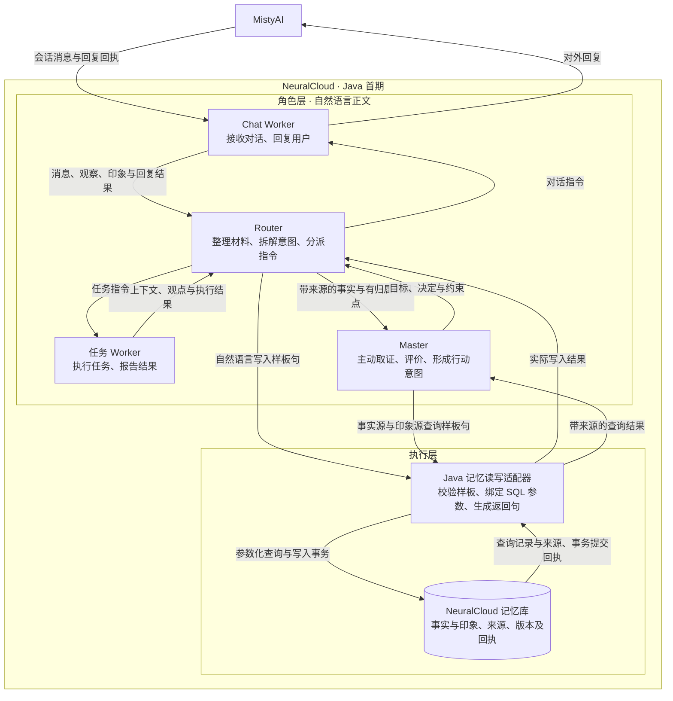
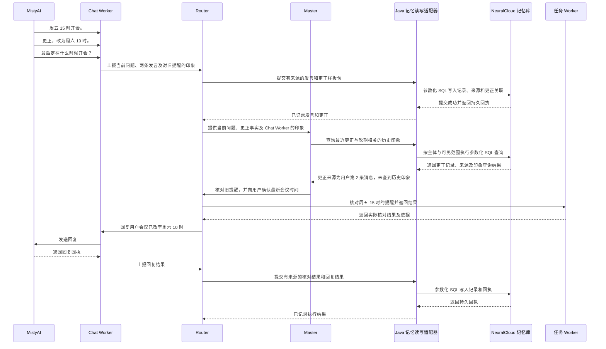

# NeuralCloud Router、Worker 与 Master 软件设计图

2026-11-19 · 首期设计稿。组件职责及实施范围以 [Java 实施方案](master-worker-router-java-implementation-20261118.md) 为准。首期采用单一主体、一个 Master、一个 Chat Worker 和一个任务 Worker，通过会议改期走通对话、取证、派单和回执入库。

## 1. 组件与接口

| 接口 | 契约 |
| --- | --- |
| Worker → Router | 上报当前事项相关的消息、观察、印象或实际执行结果。Router 保留消息顺序、来源和更正关系，印象明确标注提出者及依据。 |
| Router → Master | 同批提供事实与印象。Router 可直接把有来源的发言、更正和已确认结果提交记忆。主体态度取自 Master 的评价。 |
| Master → 记忆读写适配器 | 每次评价或决定前，按样板查询事实源与印象源。两类查询可合并调用，分别返回带来源的命中记录或无匹配结果。 |
| Master → Router → Worker | Master 提供意图与约束。Router 为指令绑定执行 Worker、所需依据和先后关系。依赖其他任务结果的指令须等该结果可用。 |
| 记忆读写适配器 → 记忆库 | 按样板选择固定 SQL 模板并绑定参数。查询应用当前主体与可见范围。写入在同一事务内提交记录、来源、版本及回执，更正保留与原记录的关联。 |

Java 运行时关联发送者、接收者、会话、证据引用、版本和回执标识。组装角色上下文时，只交付自然语言正文及可读的来源描述。这条边界覆盖 MistyAI 消息、工具反馈和记忆召回；结构化载荷、代码、命令、SQL 与原始响应留在执行层。

适配器按约定样板校验检索与写入请求，样板不匹配时指出规则并退回请求方。检索失败和成功但无匹配分别返回。只有数据库确认提交后，适配器才返回“已记录”。事实陈述以本轮实际检索返回的有效来源为依据，Worker 和 Master 的主观判断保留归属。

## 2. 首期闭环 · 会议改期

图中先保存更正再发起本轮取证，使 Master 能在首期演示中查到已提交的记录。示例按先核对、后回复执行。若回复引用提醒核对结果，Router 须将该结果作为派发回复指令的前置条件。

## 3. 首期验收

- 使用同一会话追溯原发言、更正消息、Worker 印象、Master 的两类实际查询、行动意图、指令及执行结果。
- 查询命中周六 10 时的更正，来源对应第 2 条消息。旧提醒是否存在由任务 Worker 的实际核对结果支持。
- Router 将核对任务和对话回复交给不同 Worker。MistyAI 收到周六 10 时的回复，确认的执行结果关联对应来源入库，适配器返回持久化成功。

实施前需明确 Java 适配器的 SQL 执行位置、事务所有者和字段映射。现有 [Resident v1 OpenAPI](../../contracts/resident/v1/openapi.v1.json) 可用于核对记录与回执语义。
